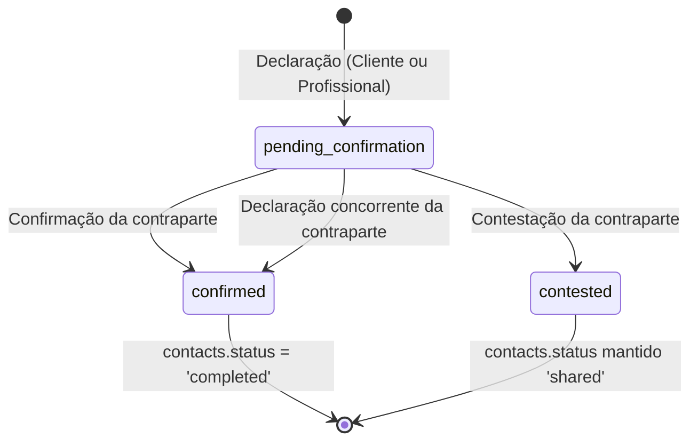

# Contact Completion & Confirmation v1

Documento canônico de arquitetura, ciclo de vida e garantias da funcionalidade de **Conclusão e Confirmação de Atendimento** (PR #15, Migration 026).

---

## 1. Visão Geral e Propósito

Após a jornada de busca, consentimento, seleção e contato bilateral estabelecido diretamente (`contacts.status = 'shared'`), o ciclo de vida do atendimento prestado precisava de uma transição auditável e bilateral para o encerramento do serviço.

O objetivo do módulo **Contact Completion & Confirmation** é:
- Permitir que qualquer uma das partes (cliente ou profissional) declare a conclusão do serviço;
- Exigir confirmação da contraparte antes de marcar o contato como `completed` (`contacts.status = 'completed'`);
- Permitir que a contraparte conteste a conclusão declarada, mantendo o serviço ativo em andamento (`contacts.status = 'shared'`) e registrando formalmente a disputa;
- Garantir serialização determinística, idempotência e notificações confiáveis via Outbox transacional sem concorrência destrutiva ou interpretação não-determinística.

---

## 2. Máquina de Estados e Ciclo de Vida

A tabela canônica `contact_completions` rastreia o estado da conclusão com chave estrangeira `contact_id` (`1:1` com `contacts`):



### Estados do Aggregate:
1. `pending_confirmation`: Uma das partes enviou comando determinístico declarando conclusão do atendimento (ação registrada no ledger como evento `'declared'`). O registro em `contact_completions` é persistido com `state = 'pending_confirmation'`, `declared_by = 'customer' | 'professional'`, `declared_at = NOW()`, e timestamps `confirmed_at` e `contested_at` nulos. A contraparte é notificada via Outbox solicitando confirmação ou contestação.
2. `confirmed`: A contraparte confirmou explicitamente a declaração (ou ambas as partes declararam de forma independente). O aggregate `contact_completions` transiciona para `state = 'confirmed'` com `confirmed_at = NOW()`. O contato em `contacts` é atualizado atomicamente para `status = 'completed'`. A tabela `contacts` não possui coluna `completed_at`; o timestamp canônico da conclusão é registrado em `contact_completions.confirmed_at`.
3. `contested`: A contraparte contestou a declaração de conclusão. O aggregate `contact_completions` transiciona para `state = 'contested'` com `contested_at = NOW()`. O contato em `contacts` permanece com `status = 'shared'`. Nenhum encerramento automático é forçado; o caso é registrado como disputa durável para eventual mediação/suporte.

---

## 3. Atores e Autorização

Os atores são estritamente bilaterais:
- **Cliente** (`customer`)
- **Profissional** (`professional`)

### Regras de Autorização:
- A identificação do emissor da mensagem recebida no canal (WhatsApp/Evolution) é verificada contra o snapshot bilateral canônico (`contacts.bilateral_snapshot`):
  - Se `phone_e164 == bilateral_snapshot.customer_phone_e164`, o ator é `customer`.
  - Se `phone_e164 == bilateral_snapshot.professional_phone_e164`, o ator é `professional`.
- Mensagens de telefones que não pertencem ao snapshot bilateral daquele código de contato recebem uma resposta genérica de indisponibilidade e são descartadas sem criar eventos ou alterar estados.
- O autor da declaração inicial **não pode** confirmar a própria declaração. Uma confirmação enviada pelo mesmo ator que declarou é rejeitada com mensagem orientando que a confirmação cabe à contraparte.
- O autor da declaração inicial **não pode** contestar a própria declaração.

---

## 4. Comandos Determinísticos

Nenhuma IA / LLM intervém no reconhecimento dos comandos de conclusão. O parser (`contact-completion.parser.ts`) avalia expressões regulares normalizadas extraindo a intenção e o código público `CC-XXXXXXXX`:

| Intenção | Comandos Reconhecidos (normalizados) | Exemplo |
| :--- | :--- | :--- |
| `declare` | `concluido CC-XXXXXXXX`<br>`concluído CC-XXXXXXXX`<br>`servico concluido CC-XXXXXXXX`<br>`serviço concluído CC-XXXXXXXX`<br>`concluido o servico CC-XXXXXXXX`<br>`concluído o serviço CC-XXXXXXXX` | `concluído CC-A1B2C3D4` |
| `confirm` | `confirmar CC-XXXXXXXX`<br>`confirmo CC-XXXXXXXX`<br>`confirmar conclusao CC-XXXXXXXX`<br>`confirmar conclusão CC-XXXXXXXX`<br>`confirmo conclusao CC-XXXXXXXX`<br>`confirmo conclusão CC-XXXXXXXX` | `confirmar CC-A1B2C3D4` |
| `contest` | `contestar CC-XXXXXXXX`<br>`contesto CC-XXXXXXXX`<br>`contestar conclusao CC-XXXXXXXX`<br>`contestar conclusão CC-XXXXXXXX`<br>`contesto conclusao CC-XXXXXXXX`<br>`contesto conclusão CC-XXXXXXXX` | `contestar CC-A1B2C3D4` |

*Notas:*
- Comandos não listados (ex.: `finalizado`, `finalizar`, `terminei`, `terminado`, `sim`, `ok`, `positivo`, `não`, `não fez`, etc.) **não** são aceitos pelo parser, preservando a disciplina de determinismo estrito sem falsos positivos.
- Mensagens contendo ponto de interrogação (`?`) são sumariamente ignoradas para evitar que dúvidas sejam tratadas como ações afirmativas.
- Se uma parte enviar `concluído CC-XXXXXXXX` enquanto houver uma declaração pendente da **contraparte**, o sistema interpreta a ação como **confirmação**, concluindo o atendimento bilateralmente.

---

## 5. Serialização, Concorrência e Ponto de Autoridade

Para prevenir corridas em ambiente `READ COMMITTED` (por exemplo, declaração simultânea do cliente e do profissional ou declaração e contestação simultâneas):
- A linha de autoridade para serialização é o registro em `contacts` (`contacts.id`).
- Toda operação inicia com:
  ```sql
  SELECT * FROM contacts WHERE id = $1 FOR UPDATE;
  ```
- Todas as mutações subsequentes (`contact_completions`, `contact_completion_events`, `channel_outbound_messages`, e `contacts.status`) são executadas atomicamente dentro da mesma transação com o lock exclusivo adquirido.

---

## 6. Eventos Auditáveis e Imutabilidade

Cada transição de estado gera um registro em `contact_completion_events`:
- Campos: `id`, `completion_id`, `contact_id`, `actor_role`, `action`, `inbound_message_id`, `created_at`.
- Ações registradas: `declared`, `confirmed`, `contested`.
- **Garantia de Imutabilidade**: Um trigger de banco de dados (`protect_contact_completion_events()`) impede `UPDATE` ou `DELETE` na tabela `contact_completion_events`, gerando a exceção PostgreSQL `P0026` (`CONTACT_COMPLETION_EVENT_IMMUTABLE`).

---

## 7. Mensageria Outbox e Deduplicação

Notificações para a contraparte e respostas para o remetente são integradas ao `channel_outbound_messages`:
- A chave de deduplicação idempotente `business_key` é utilizada para evitar duplicidade de envio de mensagens transacionais no WhatsApp:
  - Notificação de declaração para contraparte: `contact:<contactId>:completion:prompt`
  - Notificação de confirmação/encerramento para contraparte: `contact:<contactId>:completion:confirmed`
  - Notificação de contestação/disputa para contraparte: `contact:<contactId>:completion:contested`
- As mensagens de resposta ao remetente (`customer_reply` / `professional_reply`) são vinculadas diretamente a `channel_inbound_messages.response_outbound_id`.
- Chave estrangeira `channel_outbound_messages.completion_event_id` rastreia o evento causador da notificação.

---

## 8. Idempotência e Replay no Inbox

Se o webhook do canal reenviar a mesma mensagem (`provider` + `provider_message_id` idênticos):
- O Inbox reconhece a mensagem já processada (`status = 'processed'`).
- A chamada `replay()` localiza o Outbox gerado e retorna a resposta cacheada com `duplicate = true`, sem gerar nenhum novo efeito colateral nem duplicar notificações.
- Re-execuções de comandos de conclusão sobre contatos já finalizados ou contestados retornam mensagens determinísticas de estado atual sem alterar dados.

---

## 9. Isolamento em Relação a Buscas Ativas e Assinatura

- **Desacoplamento de contexto de busca ativa**: O processamento de conclusão de atendimento é uma operação no nível de contato, autorizada pelo snapshot bilateral e serializada na linha de `contacts`. Alterações em conversas de busca ativas do cliente (e consequente mudança de `context_fingerprint`) **não** geram `InboxContextChangedError` na rota de conclusão de contatos, assegurando que o comando seja processado sem interferir ou ser bloqueado pelo fluxo de busca.
- **Preservação de conversas de busca ativas**: Se um cliente estiver no meio de um fluxo de busca de outro serviço e enviar um comando determinístico de conclusão de um contato anterior (`concluído CC-XXXXXXXX`), o comando é roteado estritamente para o módulo de conclusão de contatos. A conversa de busca ativa **não é cancelada, corrompida ou sobrescrita**.
- **Independência de assinatura profissional**: Uma vez que o contato bilateral é estabelecido (`contacts.status = 'shared'`), o ciclo de vida do serviço pode ser concluído normalmente, mesmo se a assinatura do profissional expirar ou for revogada posteriormente.
- **Indisponibilidade profissional não bloqueia conclusão**: Um evento de indisponibilidade em `professional_unavailability_events` é um fato declaratório unilateral do profissional. Ele **não** cancela a conexão bilateral, **não** anula o status `shared` do contato e **não** impede que qualquer das partes inicie ou conclua o ciclo de conclusão. Declarações de indisponibilidade e evidências de conclusão coexistem no ledger como registros auditáveis independentes.

---

## 10. Desacoplamento de Avaliações e Reputação

O módulo de conclusão de atendimento é deliberadamente separado de avaliações:
- **Zero código de estrelas, notas ou reputação** foi inserido no PR #15.
- A conclusão confirmada (`contacts.status = 'completed'`) servirá como pré-requisito e token de elegibilidade para que o cliente possa avaliar o profissional em uma etapa futura de engenharia (*Reviews & Ratings* — sem número de PR atribuído, pois o PR #16 corresponde à reconciliação canônica de documentação).
