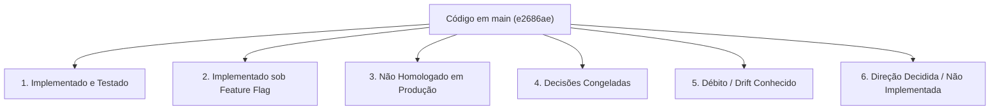

# Estado Atual do Sistema (Current State)

Este documento registra a realidade técnica, funcional e operacional do **ContatoCerto** com base no commit consolidado no branch `main`:
**`e2686ae73edbd6080c125431bb408a1a8e921c20`** (após o merge do PR #15).

---

## 🧭 Visão Geral por Status de Entrega

---

## 1. Implementado no Repositório (Fundação Validada em CI)

As seguintes capacidades encontram-se implementadas, cobertas por testes automatizados e integradas ao `main`:

### Busca, Catálogo e Ranking Espacial
* **Resolução Determinística de Serviços:** Mapeamento de termos e sinônimos com tolerância a variações linguísticas e cálculo de relevância (`SERVICE_RESOLUTION_FUZZY_THRESHOLD=0.53`).
* **Resolução Geográfica de Municípios:** Base completa de municípios brasileiros do IBGE com indexação espacial PostGIS, suporte a ambiguidades e fallback via geocodificador HeiGIT/Pelias.
* **Algoritmo de Matching e Ranking:** Seleção espacial com rotação justa (*fair-v1*), pool máximo de 20 profissionais, paginação de 3 em 3 e teto máximo de apresentação de 6 profissionais por busca.

### Contato Bilateral e Consentimento
* **Transação Bilateral Atômica:** Criação atômica do registro de contato (`contacts`), snapshot dos dados cadastrais das partes no instante da escolha, vinculação a `matches` e geração de código público `CC-XXXXXXXX`.
* **Consentimento de Compartilhamento:** A seleção explícita pelo cliente após apresentação dos dados constitui consentimento formal para compartilhamento mútuo de telefones via WhatsApp.

### Durabilidade de Mensageria (Inbox & Outbox)
* **Inbox Durável:** Registro idempotente de mensagens recebidas de webhook, deduplicação por hash de conteúdo/timestamp, controle de lease (`CHANNEL_INBOUND_PROCESSING_LEASE_SECONDS=60`), quarentena administrativa de mensagens conflitantes e processamento FIFO.
* **Outbox Durável:** Tabela de mensagens a enviar com controle transacional de lease (`CHANNEL_OUTBOUND_PROCESSING_LEASE_SECONDS=60`), claim atômico por token UUID, tentativas com backoff exponencial e retenção de auditoria.
* **Sanitização de Logs e Diagnóstico:** Mascaramento obrigatório de dados pessoais (PII / telefones) em logs e endpoints de diagnóstico agregado da fila (`GET /internal/channel/inbox/diagnostics`).

### Identidade e Governança Profissional (PRs #10 a #13)
* **Identidade Individual (`accounts`):** Separação entre credenciais de acesso individuais e entidades profissionais cadastradas (`professionals`).
* **Autenticação Sem Senha (OTP):** Envio de código OTP de 6 dígitos por e-mail com hash com salt + pepper criptográfico (`PROFESSIONAL_AUTH_PEPPER`), taxa de limite estrita e expiração em 15 minutos.
* **Autocadastro e Reivindicação Legada (Claim):** Fluxo para novos profissionais criarem contas e vincularem registros legados existentes via validação de dados prévios.
* **Máquina de Estados de Elegibilidade:** Validação de perfil profissional (`draft`, `pending`, `active`, `suspended`, `inactive`), cobertura de categorias e regras de ativação para participação no ranking.

### Assinaturas e Direitos de Acesso — Provider-Neutral (PR #14)
* **Domínio de Planos e Assinaturas (Migration 025):** Tabelas `subscription_plans` e `professional_subscriptions` totalmente desacopladas de gateways de pagamento.
* **Entitlements para Oportunidades:** Verificação atômica de assinatura ativa durante a seleção do cliente. A transação adquire lock compartilhado de autoridade (`FOR UPDATE OF professionals`) e revalida se o profissional possui assinatura vigente antes de entregar o lead.

### Conclusão e Confirmação de Atendimentos (PR #15)
* **Ciclo de Conclusão Bilateral (Migration 026):** Permite que profissional ou cliente declarem a conclusão do serviço (`concluído CC-XXXXXXXX`).
* **Confirmação e Contestação Determinística:** O cliente pode confirmar (`confirmar CC-XXXXXXXX`) ou contestar (`contestar CC-XXXXXXXX`).
* **Isolamento de Contexto:** Comandos determinísticos de conclusão operam a nível de contato persistido e snapshot bilateral, sem depender de sessão ativa de busca (`search_conversation`).

### Painel Web do Profissional (`apps/web`)
* **Portal Next.js em `/dashboard`:** Implementação com BFF (Backend for Frontend), sessões via cookie assinado, visualização de status da conta, dados cadastrais, cobertura geográfica e lista de atendimentos.

---

## 2. Implementado no Repositório, mas sob Feature Flag (Desativado por Padrão)

| Funcionalidade | Variável Canônica | Padrão | Descrição |
| :--- | :--- | :---: | :--- |
| **Conversação Contextual Híbrida (IA)** | `CONVERSATION_AI_ENABLED` | `false` | Motor B2 que combina memória contextual, hipóteses e chamadas de modelo OpenAI. Quando desligado, opera apenas o fluxo determinístico estruturado. *(Nota: tem precedência sobre o alias legado `CONTEXTUAL_CONVERSATION_ENABLED`)*. |
| **Fallback de Interpretação por IA** | `MESSAGE_INTERPRETATION_FALLBACK_ENABLED` | `false` | Chamada LLM para extração de localização quando a resolução determinística falha. |
| **Autenticação Profissional OTP** | `PROFESSIONAL_AUTH_ENABLED` | `false` | Habilita o endpoint público de emissão e consumo de OTP no portal web. |

---

## 3. Estado Instalado / Externo Conhecido (Evidência do Operador)

Com base nos dados fornecidos pelo operador da infraestrutura instalada (EasyPanel, n8n v1.123.21 e Evolution API v2.3.7):
* **WhatsApp Gateway:** Ativo no n8n remoto (recebendo webhooks da Evolution API e repassando para a API do ContatoCerto).
* **Durable Audio Consumer:** Ativo no n8n remoto (consumindo áudios da Evolution e enviando para transcrição/processamento).
* **Inbox Recovery:** Ativo no n8n remoto (cron recuperando mensagens da Inbox travadas com lease expirado).
* **Outbox Dispatcher:** Ativo no n8n remoto (cron chamando `/claim` da Outbox a cada minuto).
* **Shared Outbox Delivery:** Utilizado como subfluxo chamado pelo Dispatcher (no arquivo exportado consta com status `active: false` porque é invocado como subworkflow).

---

## 4. Não Homologado em Produção

* **Transporte Real com Telefones Físicos:** Testes de ponta a ponta com instâncias reais de WhatsApp e operadores humanos em larga escala.
* **Avaliação de Modelos de Linguagem Reais:** Validação de custo, tempo de resposta e qualidade conversacional em ambiente de produção com tráfego real.
* **Testes de Carga e Concorrência de Mensagens:** Testes de estresse da fila sob alto volume concorrente.
* **Testes E2E de Navegador:** Cobertura automatizada E2E via Playwright/Cypress no painel web.

---

## 5. Decisões Formalmente Congeladas

* **Gateways de Pagamento e Cobrança ([ADR-003](decisions/ADR-003-billing-provider-decision-frozen.md)):**
  * Nenhuma integração com Stripe, Mercado Pago, Asaas, Pagar.me, etc.
  * Nenhum fluxo de checkout, emissão de boletos, cartões ou Pix para cobrança de assinaturas.
  * Nenhum webhook financeiro ou reconciliação bancária.
  * Cupons, descontos e programas de cashback atrelados a dinheiro estão terminantemente proibidos no escopo atual.

---

## 6. Funcionalidades Não Implementadas (Backlog Futuro)

* **Avaliações e Reputação de Profissionais (Reviews & Ratings):** Coleta estruturada de notas, comentários e impacto no algoritmo de ranking.
* **Painel Administrativo para Operadores:** Interface gráfica para moderação de conteúdo, visualização de quarentena e gestão de cadastros.
* **Inputs Avançados de Localização (Location v2):** Compartilhamento de localização nativa do WhatsApp (Live Location), links de Google Maps ou detecção de CEP por geolocalização móvel.

---

## 7. Débitos de Versão e Divergências Conhecidas (Drift)

* **Divergência entre n8n Versionado e n8n Instalado:**
  * O workflow `workflows/n8n/shared-delivery.json` versionado em `main` suporta novas finalidades de mensagem, notadamente `professional_auth_challenge` (código OTP de login).
  * O arquivo exportado da instância n8n instalada pelo operador ainda não contém suporte a esse propósito de mensagem.
  * **Ação Necessária:** O operador precisará atualizar o workflow instalado no n8n antes de habilitar `PROFESSIONAL_AUTH_ENABLED=true` em produção. (Registrado no [ROADMAP.md](ROADMAP.md) sob `# NOW`).

---

## 8. Descompasso Conceitual Conhecido: Ciclo de Conexão (CURRENT vs. TARGET)

> [!CAUTION]
> **Atenção — Regra Crítica de Governança de Produto:**
> No código atual em `main`, o ciclo de atendimento ainda exige transições baseadas em ações profissionais (`contacts.status = 'accepted'` ou `'rejected'`) para determinadas etapas do ciclo de vida.
>
> **A direção de produto decidida ([ADR-004](decisions/ADR-004-connection-lifecycle-v2-direction.md)) estabelece que:**
> A conexão é estabelecida no exato momento em que o **cliente seleciona o profissional** com consentimento mútuo de dados. O aceite do profissional **NÃO deve ser obrigatório** para que o contato exista e os telefones sejam trocados.
>
> **Status:** `ACEITO / NÃO IMPLEMENTADO NO CÓDIGO`.
> Nenhum desenvolvedor ou agente deve presumir que essa regra já está ativa no código atual. A alteração está planejada para a próxima frente técnica.
