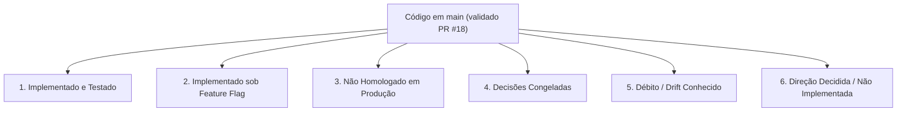

# Estado Atual do Sistema (Current State)

Este documento registra a realidade técnica, funcional e operacional do **ContatoCerto** com base no histórico canônico do branch `main` (validado através do PR #18 / histórico canônico do main).

> [!NOTE]
> **Fase atual: Launch Readiness / Homologação.** O Checkpoint A de auditoria da realidade atual foi executado em 2026-09-28 e seu resultado detalhado encontra-se em [`docs/launch-readiness/00-current-reality-audit.md`](launch-readiness/00-current-reality-audit.md).

---

## 🧭 Visão Geral por Status de Entrega

---

## 1. Implementado no Repositório (Fundação Validada em CI)

As seguintes capacidades encontram-se implementadas, cobertas por testes automatizados e integradas ao `main`:

### Busca, Catálogo e Ranking Espacial
* **Resolução Determinística de Serviços:** Mapeamento de termos e sinônimos com tolerância a variações linguísticas e cálculo de relevância (`SERVICE_RESOLUTION_FUZZY_THRESHOLD=0.53`).
* **Resolução Geográfica de Municípios:** Resolução determinística em memória a partir do snapshot versionado de municípios brasileiros do IBGE (`apps/api/src/modules/location-resolution/data/brazil-municipalities.json`), com desambiguação exata cidade/UF e fallback via geocodificador HeiGIT/Pelias.
* **Cobertura Espacial PostGIS:** O PostGIS é utilizado especificamente para a geometria de cobertura dos profissionais na tabela `professional_service_areas` (`center` e `radius_meters`), cálculo de distância via `ST_DWithin` e ordenação do matching. O índice IBGE em si não depende do PostGIS para resolução.
* **Algoritmo de Matching e Ranking:** Seleção espacial com rotação justa (*fair-v1*), pool máximo de 20 profissionais, paginação de 3 em 3 e teto máximo de apresentação de 6 profissionais por busca.

### Contato Bilateral e Consentimento (Ciclo de Conexão v2 — Migration 027)
* **Transação Bilateral Atômica:** Criação atômica do registro de contato (`contacts`) diretamente no status `shared`, snapshot dos dados cadastrais das partes no instante da escolha, vinculação a `matches` e geração de código público `CC-XXXXXXXX`.
* **Conexão Imediata sem Segundo Aceite Obrigatório:** O consentimento informado do cliente para o compartilhamento recíproco de dados estabelece a conexão imediatamente. Ambas as partes recebem os contatos via WhatsApp.
* **Declaração Opcional de Indisponibilidade Profissional:** Respostas de recusa ("não consigo", "recuso", etc.) geram registro imutável em `professional_unavailability_events` (ERRCODE P0027), mantêm o contato como `shared`, reabrem a busca para nova seleção do cliente e notificam o cliente via Outbox.
* **Múltiplas Conexões por Busca:** O índice único `(search_request_id, professional_id)` permite que o cliente selecione outro profissional caso o primeiro declare indisponibilidade.
* **Normalização Histórica:** Contatos bilaterais legados em `requested`, `accepted` ou `declined` foram normalizados para `shared` pela Migration 027, preservando o histórico em `opportunity_response_events`.

### Durabilidade de Mensageria (Tabelas de Fila)
* **Inbox Durável (`channel_inbound_messages`):** Tabela de persistência idempotente para mensagens recebidas via webhook da borda, com deduplicação e idempotência durável baseadas no par único `(provider, provider_message_id)` via `ON CONFLICT DO NOTHING`. O hashing de evidências do payload é utilizado para detecção de divergência e quarentena de conflitos caso a mesma identidade de mensagem seja recebida com conteúdo conflitante. Possui controle transacional de lease (`CHANNEL_INBOUND_PROCESSING_LEASE_SECONDS=60`) e processamento FIFO.
* **Outbox Durável (`channel_outbound_messages`):** Tabela de persistência para mensagens a enviar com controle de lease (`CHANNEL_OUTBOUND_PROCESSING_LEASE_SECONDS=60`), claim atômico por token UUID, tentativas com backoff exponencial e retenção de auditoria.
* **Sanitização de Logs e Telemetria de Fila:** Mascaramento obrigatório de dados pessoais (PII / telefones) em logs e monitoramento do estado da fila via `GET /internal/channel/inbound/queue-status`.

### Identidade e Governança Profissional (PRs #10 a #13)
* **Identidade Individual (`accounts`):** Separação entre credenciais de acesso individuais e entidades profissionais cadastradas (`professionals`).
* **Autenticação Sem Senha (OTP via WhatsApp):** Envio de código OTP de 6 dígitos diretamente para o WhatsApp do profissional (`phone_e164`) através da Outbox durável (`professional_auth_challenge`). O código possui TTL estrito de 5 minutos (`OTP_TTL_SECONDS = 300`) e proteção por derivação de chave/HMAC via `PROFESSIONAL_AUTH_PEPPER`.
* **Autocadastro e Reivindicação Legada (Claim):** Fluxo para novos profissionais criarem contas e vincularem registros legados existentes via validação de dados prévios.
* **Governança de Status Profissional:** O enum `professional_status` no banco possui exatamente três estados: `'draft'`, `'active'` e `'suspended'`.

### Assinaturas e Direitos de Acesso — Provider-Neutral (PR #14)
* **Domínio de Planos e Assinaturas (Migration 025):** Tabelas `subscription_plans` e `professional_subscriptions` totalmente desacopladas de gateways de pagamento.
* **Entitlements para Oportunidades:** Verificação atômica de assinatura ativa durante a seleção do cliente. A transação adquire lock compartilhado de autoridade (`FOR UPDATE OF professionals`) e revalida se o profissional possui assinatura vigente antes de entregar o lead.
* **Política de Transição Legada:** Profissionais gerenciados por conta (`management_mode = 'account_managed'`) exigem assinatura ativa para receber leads. Perfis legados não reivindicados (`management_mode = 'legacy_unmanaged'`) permanecem temporariamente isentos de assinatura sob a política de compatibilidade legada.

### Conclusão e Confirmação de Atendimentos (PR #15 / PR #17 / PR #18)
* **Ciclo de Conclusão Bilateral (Migration 026 / Migration 027):** Qualquer uma das partes (profissional ou cliente) pode declarar a conclusão do serviço. A elegibilidade para conclusão é direta a partir do status `shared`.
* **Comandos com Código-Livre ou Código Público (PR #18):** Declarações de conclusão ("já terminei", "concluído"), confirmações ("confirmo") e contestações ("não foi concluído") resolvem automaticamente quando existe 1 único contato ativo/elegível ou 1 confirmação pendente. Quando existem múltiplos contatos em andamento, o sistema faz pergunta de esclarecimento sem expor telefones.
* **Confirmação e Contestação Bilateral:** A contraparte pode confirmar ou contestar a declaração. O modelo de estados é `pending_confirmation`, `confirmed` e `contested`. Contestações mantêm o contato no status `shared`.
* **Isolamento de Contexto:** Comandos determinísticos de conclusão operam a nível de contato persistido e snapshot bilateral.

### Inteligência de Conversa e Seleção v2 (PR #18)
* **Interação Natural na Seleção:** Durante a apresentação de opções de busca (`pendingSlot = 'selection'`), o cliente pode tirar dúvidas sobre prestadores apresentados ("me fale mais do João", "onde fica o Carlos?", "qual o mais perto?", "qual o mais barato?", "compara os dois", "tem mais opções?") mantendo a busca ativa sem realizar escolha indesejada.
* **Barreira de Segurança Pergunta vs Seleção (ADR-002):** Perguntas sobre um candidato jamais selecionam ou compartilham contato do profissional. A escolha ocorre apenas com intenção explícita de contratação ("quero o João", "opção 1").
* **Respostas Factuais Determinísticas (0 Chamada de Composição):** Respostas sobre distância, preço, verificação, detalhes e recomendações factuais são formatadas por apresentadores determinísticos, sem gerar chamadas adicionais de composição à IA e sem inventar endereços residenciais ou indicar "vencedores" subjetivos.
* **Fast Paths Determinísticos (0 Chamada de IA):** Consultas diretas como "qual o mais perto?" e "qual o mais barato?" executam via rotas determinísticas em memória com 0 chamadas a provedores externos de IA.
* **Pacote de Contexto Seguro e Limitado:** Informações enviadas ao modelo de interpretação contêm apenas fatos públicos dos candidatos apresentados (até 6), omitindo telefones, e-mails, links e histórico bruto da conversa.

### Painel Web do Profissional (`apps/web`)
* **Portal Next.js em `/dashboard`:** Implementação com BFF (Backend for Frontend) e sessões via cookie assinado.
* **Seções Implementadas no Código:** Visão geral (`overview`), dados de perfil (`profile`), categorias de serviços (`services`), áreas de cobertura (`service-areas`), disponibilidade (`availability`), controles de elegibilidade e fluxos de onboarding/claim.
* **Telefone em Modo Somente-Leitura:** No painel atual, o telefone do profissional é exibido como `readOnly` e não pode ser alterado diretamente pelo autosserviço (exige intervenção administrativa).
* **Ausência de Histórico de Atendimentos / Conclusão no Painel:** O painel atual não possui tela de histórico de serviços nem botões de conclusão de atendimento.

---

## 2. Implementado no Repositório, mas sob Feature Flag (Desativado por Padrão no Código)

| Funcionalidade | Variável Canônica | Padrão no Código | Observação de Ambiente |
| :--- | :--- | :---: | :--- |
| **Conversação Contextual Híbrida (IA)** | `CONVERSATION_AI_ENABLED` | `false` | Motor B2 que combina memória contextual, hipóteses e chamadas OpenAI. *(Nota: tem precedência sobre o alias legado `CONTEXTUAL_CONVERSATION_ENABLED`). Embora o padrão de código seja `false`, relatórios do operador indicam que o ambiente instalado pode ter sido configurado com `true`.* |
| **Fallback de Interpretação por IA** | `MESSAGE_INTERPRETATION_FALLBACK_ENABLED` | `false` | Chamada LLM para extração de localização quando a resolução determinística falha. |
| **Autenticação Profissional OTP** | `PROFESSIONAL_AUTH_ENABLED` | `false` | Habilita o endpoint público de emissão e validação de OTP de 6 dígitos no WhatsApp. |

---

## 3. Estado Instalado / Externo Conhecido (Evidência do Operador — Não Reverificada no Checkpoint A)

Com base nos dados fornecidos pelo operador da infraestrutura instalada em checkpoint anterior (EasyPanel, n8n v1.123.21 e Evolution API v2.3.7):
* **WhatsApp Gateway:** Ativo no n8n remoto (recebendo webhooks da Evolution API e repassando para a API do ContatoCerto).
* **Durable Audio Consumer:** Ativo no n8n remoto (reivindicando mídias de áudio, orquestrando transcrição via Groq com fallback para OpenAI e persistindo o resultado).
* **Inbox Recovery:** Ativo no n8n remoto (cron recuperando mensagens da tabela `channel_inbound_messages` travadas com lease expirado).
* **Outbox Dispatcher:** Ativo no n8n remoto (cron chamando `/internal/channel/outbound/next/claim` a cada minuto).
* **Shared Outbox Delivery:** Utilizado como subfluxo chamado pelo Dispatcher (no arquivo exportado consta com status `active: false` porque é invocado como subworkflow).

---

## 4. Testes Operacionais e Homologação Pendente

* **Transporte WhatsApp Real:** Embora testes manuais reais com números físicos de WhatsApp tenham sido reportados pelo operador, a **homologação formal de ponta a ponta da esteira de lançamento**, testes de carga/concorrência sob múltiplos números simultâneos e certificação de produção completa permanecem pendentes.
* **Avaliação de Modelos de Linguagem Reais:** Avaliação empírica de latência, precisão e custos com tráfego real.
* **Testes E2E de Navegador:** Cobertura automatizada do portal web via Playwright.

---

## 5. Decisões Formalmente Congeladas

* **Gateways de Pagamento e Cobrança ([ADR-003](decisions/ADR-003-billing-provider-decision-frozen.md)):**
  * Nenhuma integração com Stripe, Mercado Pago, Asaas, Pagar.me, etc.
  * Nenhum fluxo de checkout, emissão de boletos, cartões ou Pix para cobrança de assinaturas.
  * Nenhum webhook financeiro ou conciliação bancária.
  * Cupons, descontos e programas de afiliados vinculados a dinheiro estão terminantemente proibidos no escopo atual.

---

## 6. Funcionalidades Não Implementadas (Backlog Futuro)

* **Avaliações e Reputação de Profissionais (Reviews & Ratings):** Coleta estruturada de notas e depoimentos após confirmação de conclusão.
* **Painel Administrativo para Operadores:** Interface gráfica para moderação de conteúdo e gestão de quarentena.
* **Inputs Avançados de Localização (Location v2):** Compartilhamento de localização nativa do WhatsApp (Live Location), links de mapas ou detecção automática por geolocalização.
* **Conclusão de Serviços pelo Painel Web:** Ação de marcar serviço como concluído na interface web (atualmente exclusiva via WhatsApp).

---

## 7. Débitos de Versão e Divergências Conhecidas (Drift)

* **Divergência entre n8n Versionado e n8n Instalado:**
  * O workflow `workflows/n8n/shared-delivery.json` versionado em `main` suporta o propósito de mensagem `professional_auth_challenge` (desafio de login OTP).
  * O arquivo exportado da instância n8n instalada pelo operador ainda não contém suporte a esse propósito de mensagem.
  * **Ação Necessária:** O operador precisará atualizar o workflow instalado no n8n antes de habilitar `PROFESSIONAL_AUTH_ENABLED=true` em produção. (Registrado no [ROADMAP.md](ROADMAP.md) sob `# NOW`).

---

## 8. Ciclo de Conexão Bilateral v2 (Implementado no PR #17 via Migration 027)

* **Direção Canônica Consolidada ([ADR-004](decisions/ADR-004-connection-lifecycle-v2-direction.md)):**
  $$\text{Participação elegível do profissional} + \text{Seleção ativa do cliente} + \text{Consentimento informado do cliente para compartilhamento bilateral dos contatos} = \mathbf{CONEX\tilde{A}O\ ESTABELECIDA}$$
* **Sem Aceite Obrigatório:** O contato é imediatamente persistido como `shared`. Frases como "aceito" ou "posso atender" atuam como confirmações de cortesia sem alterar o status da conexão.
* **Indisponibilidade Profissional:** Registrada em `professional_unavailability_events` (tabela append-only imutável com proteção `P0027`). Mantém o contato `shared`, reativa a busca para o cliente escolher outro profissional e notifica o cliente.
* **Concorrência e Locks Determinísticos:** Locks ordenados em `customers`, `search_conversations`, `search_requests` e `contacts FOR NO KEY UPDATE` evitam deadlocks entre seleções, indisponibilidade e conclusão de atendimento.
