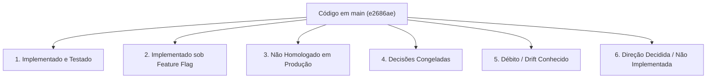

# Estado Atual do Sistema (Current State)

Este documento registra a realidade técnica, funcional e operacional do **ContatoCerto** com base no commit consolidado no branch `main`:
**`e2686ae73edbd6080c125431bb408a1a8e921c20`** (após o merge do PR #15).

---

## 🧭 Visão Geral por Status de Entrega

---

## 1. Implementado no Repositório (Fundação Validada em CI)

As seguintes capacidades encontram-se implementadas, cobertas por testes automatizados e integradas ao `main`:

### Busca, Catálogo e Ranking Espacial
* **Resolução Determinística de Serviços:** Mapeamento de termos e sinônimos com tolerância a variações linguísticas e cálculo de relevância (`SERVICE_RESOLUTION_FUZZY_THRESHOLD=0.53`).
* **Resolução Geográfica de Municípios:** Resolução determinística em memória a partir do snapshot versionado de municípios brasileiros do IBGE (`apps/api/src/modules/location-resolution/data/brazil-municipalities.json`), com desambiguação exata cidade/UF e fallback via geocodificador HeiGIT/Pelias.
* **Cobertura Espacial PostGIS:** O PostGIS é utilizado especificamente para a geometria de cobertura dos profissionais (`service_areas.radius_km`), cálculo de distância via `ST_DWithin` e ordenação do matching. O índice IBGE em si não depende do PostGIS para resolução.
* **Algoritmo de Matching e Ranking:** Seleção espacial com rotação justa (*fair-v1*), pool máximo de 20 profissionais, paginação de 3 em 3 e teto máximo de apresentação de 6 profissionais por busca.

### Contato Bilateral e Consentimento
* **Transação Bilateral Atômica:** Criação atômica do registro de contato (`contacts`), snapshot dos dados cadastrais das partes no instante da escolha, vinculação a `matches` e geração de código público `CC-XXXXXXXX`.
* **Consentimento de Compartilhamento:** A seleção explícita pelo cliente após apresentação dos dados constitui consentimento formal para compartilhamento mútuo de telefones via WhatsApp.

### Durabilidade de Mensageria (Tabelas de Fila)
* **Inbox Durável (`channel_inbound_messages`):** Tabela de persistência idempotente para mensagens recebidas via webhook da borda, deduplicação por hash de conteúdo/timestamp, controle transacional de lease (`CHANNEL_INBOUND_PROCESSING_LEASE_SECONDS=60`), quarentena administrativa de mensagens conflitantes e processamento FIFO.
* **Outbox Durável (`channel_outbound_messages`):** Tabela de persistência para mensagens a enviar com controle de lease (`CHANNEL_OUTBOUND_PROCESSING_LEASE_SECONDS=60`), claim atômico por token UUID, tentativas com backoff exponencial e retenção de auditoria.
* **Sanitização de Logs e Diagnóstico:** Mascaramento obrigatório de dados pessoais (PII / telefones) em logs e endpoints de diagnóstico agregado da fila (`GET /internal/channel/inbox/diagnostics`).

### Identidade e Governança Profissional (PRs #10 a #13)
* **Identidade Individual (`accounts`):** Separação entre credenciais de acesso individuais e entidades profissionais cadastradas (`professionals`).
* **Autenticação Sem Senha (OTP via WhatsApp):** Envio de código OTP de 6 dígitos diretamente para o WhatsApp do profissional (`phone_e164`) através da Outbox durável (`professional_auth_challenge`). O código possui TTL estrito de 5 minutos (`OTP_TTL_SECONDS = 300`) e proteção por derivação de chave/HMAC via `PROFESSIONAL_AUTH_PEPPER`.
* **Autocadastro e Reivindicação Legada (Claim):** Fluxo para novos profissionais criarem contas e vincularem registros legados existentes via validação de dados prévios.
* **Governança de Status Profissional:** O enum `professional_status` no banco possui exatamente três estados: `'draft'`, `'active'` e `'suspended'`.

### Assinaturas e Direitos de Acesso — Provider-Neutral (PR #14)
* **Domínio de Planos e Assinaturas (Migration 025):** Tabelas `subscription_plans` e `professional_subscriptions` totalmente desacopladas de gateways de pagamento.
* **Entitlements para Oportunidades:** Verificação atômica de assinatura ativa durante a seleção do cliente. A transação adquire lock compartilhado de autoridade (`FOR UPDATE OF professionals`) e revalida se o profissional possui assinatura vigente antes de entregar o lead.
* **Política de Transição Legada:** Profissionais gerenciados por conta (`management_mode = 'account_managed'`) exigem assinatura ativa para receber leads. Perfis legados não reivindicados (`management_mode = 'legacy_unmanaged'`) permanecem temporariamente isentos de assinatura sob a política de compatibilidade legada.

### Conclusão e Confirmação de Atendimentos (PR #15)
* **Ciclo de Conclusão Bilateral (Migration 026):** Qualquer uma das partes (profissional ou cliente) pode declarar a conclusão do serviço (`concluído CC-XXXXXXXX`).
* **Confirmação e Contestação Bilateral:** A contraparte (cliente ou profissional) pode confirmar (`confirmar CC-XXXXXXXX`) ou contestar (`contestar CC-XXXXXXXX`). O modelo de estados é `pending_confirmation`, `confirmed` e `contested`.
* **Comandos Determinísticos com Código Obrigatório:** No código atual, os comandos de conclusão, confirmação e contestação exigem obrigatoriamente a presença do código público `CC-XXXXXXXX` no texto recebido.
* **Isolamento de Contexto:** Comandos determinísticos de conclusão operam a nível de contato persistido e snapshot bilateral, sem depender de sessão ativa de busca (`search_conversation`).

### Painel Web do Profissional (`apps/web`)
* **Portal Next.js em `/dashboard`:** Implementação com BFF (Backend for Frontend) e sessões via cookie assinado.
* **Seções Implementadas no Código:** Visão geral (`overview`), dados de perfil (`profile`), categorias de serviços (`services`), áreas de cobertura (`service-areas`), disponibilidade (`availability`), controles de elegibilidade e fluxos de onboarding/claim.
* **Telefone em Modo Somente-Leitura:** No painel atual, o telefone do profissional é exibido como `readOnly` e não pode ser alterado diretamente pelo autosserviço (exige intervenção administrativa).
* **Ausência de Histórico de Atendimentos / Conclusão no Painel:** O painel atual não possui tela de histórico de serviços nem botões de conclusão de atendimento.

---

## 2. Implementado no Repositório, mas sob Feature Flag (Desativado por Padrão no Código)

| Funcionalidade | Variável Canônica | Padrão no Código | Observação de Ambiente |
| :--- | :--- | :---: | :--- |
| **Conversação Contextual Híbrida (IA)** | `CONVERSATION_AI_ENABLED` | `false` | Motor B2 que combina memória contextual, hipóteses e chamadas OpenAI. *(Nota: tem precedência sobre o alias legado `CONTEXTUAL_CONVERSATION_ENABLED`). Embora o padrão de código seja `false`, relatórios do operador indicam que o ambiente instalado pode ter sido configurado com `true`.* |
| **Fallback de Interpretação por IA** | `MESSAGE_INTERPRETATION_FALLBACK_ENABLED` | `false` | Chamada LLM para extração de localização quando a resolução determinística falha. |
| **Autenticação Profissional OTP** | `PROFESSIONAL_AUTH_ENABLED` | `false` | Habilita o endpoint público de emissão e validação de OTP de 6 dígitos no WhatsApp. |

---

## 3. Estado Instalado / Externo Conhecido (Evidência do Operador)

Com base nos dados fornecidos pelo operador da infraestrutura instalada (EasyPanel, n8n v1.123.21 e Evolution API v2.3.7):
* **WhatsApp Gateway:** Ativo no n8n remoto (recebendo webhooks da Evolution API e repassando para a API do ContatoCerto).
* **Durable Audio Consumer:** Ativo no n8n remoto (reivindicando mídias de áudio, orquestrando transcrição via Groq com fallback para OpenAI e persistindo o resultado).
* **Inbox Recovery:** Ativo no n8n remoto (cron recuperando mensagens da tabela `channel_inbound_messages` travadas com lease expirado).
* **Outbox Dispatcher:** Ativo no n8n remoto (cron chamando `/internal/channel/outbound/next/claim` a cada minuto).
* **Shared Outbox Delivery:** Utilizado como subfluxo chamado pelo Dispatcher (no arquivo exportado consta com status `active: false` porque é invocado como subworkflow).

---

## 4. Testes Operacionais e Homologação Pendente

* **Transporte WhatsApp Real:** Embora testes manuais reais com números físicos de WhatsApp tenham sido reportados pelo operador, a **homologação formal de ponta a ponta da esteira de lançamento**, testes de carga/concorrência sob múltiplos números simultâneos e certificação de produção completa permanecem pendentes.
* **Avaliação de Modelos de Linguagem Reais:** Avaliação empírica de latência, precisão e custos com tráfego real.
* **Testes E2E de Navegador:** Cobertura automatizada do portal web via Playwright.

---

## 5. Decisões Formalmente Congeladas

* **Gateways de Pagamento e Cobrança ([ADR-003](decisions/ADR-003-billing-provider-decision-frozen.md)):**
  * Nenhuma integração com Stripe, Mercado Pago, Asaas, Pagar.me, etc.
  * Nenhum fluxo de checkout, emissão de boletos, cartões ou Pix para cobrança de assinaturas.
  * Nenhum webhook financeiro ou conciliação bancária.
  * Cupons, descontos e programas de afiliados vinculados a dinheiro estão terminantemente proibidos no escopo atual.

---

## 6. Funcionalidades Não Implementadas (Backlog Futuro)

* **Avaliações e Reputação de Profissionais (Reviews & Ratings):** Coleta estruturada de notas e depoimentos após confirmação de conclusão.
* **Painel Administrativo para Operadores:** Interface gráfica para moderação de conteúdo e gestão de quarentena.
* **Inputs Avançados de Localização (Location v2):** Compartilhamento de localização nativa do WhatsApp (Live Location), links de mapas ou detecção automática por geolocalização.
* **Conclusão de Serviços pelo Painel Web:** Ação de marcar serviço como concluído na interface web (atualmente exclusiva via WhatsApp).

---

## 7. Débitos de Versão e Divergências Conhecidas (Drift)

* **Divergência entre n8n Versionado e n8n Instalado:**
  * O workflow `workflows/n8n/shared-delivery.json` versionado em `main` suporta o propósito de mensagem `professional_auth_challenge` (desafio de login OTP).
  * O arquivo exportado da instância n8n instalada pelo operador ainda não contém suporte a esse propósito de mensagem.
  * **Ação Necessária:** O operador precisará atualizar o workflow instalado no n8n antes de habilitar `PROFESSIONAL_AUTH_ENABLED=true` em produção. (Registrado no [ROADMAP.md](ROADMAP.md) sob `# NOW`).

---

## 8. Descompasso Conceitual Conhecido: Ciclo de Conexão (CURRENT vs. TARGET)

> [!CAUTION]
> **Atenção — Regra Crítica de Governança de Produto:**
> No código atual em `main`, o ciclo de atendimento ainda contém estados legados como `accepted` e `declined` no enum `contact_status` (`'requested'`, `'shared'`, `'accepted'`, `'declined'`, `'completed'`, `'cancelled'`), exigindo em certas rotas que o profissional aceite o lead.
>
> **A direção de produto decidida ([ADR-004](decisions/ADR-004-connection-lifecycle-v2-direction.md)) estabelece que:**
> Participação elegível do profissional + seleção ativa do cliente + consentimento informado de compartilhamento bilateral = **CONEXÃO ESTABELECIDA**.
> O aceite do profissional **NÃO deve ser obrigatório** para que a oportunidade exista e os telefones sejam trocados.
>
> **Status:** `ACEITO / NÃO IMPLEMENTADO NO CÓDIGO`.
> Nenhum desenvolvedor ou agente deve presumir que essa regra já está ativa no código atual. A alteração está planejada para a próxima frente técnica.
