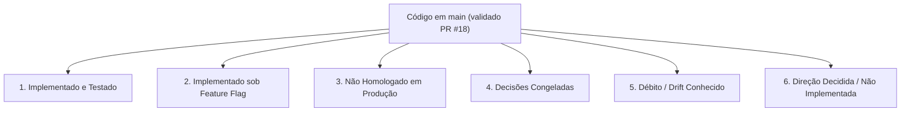

# Estado Atual do Sistema (Current State)

Este documento registra a realidade técnica, funcional e operacional do **ContatoCerto** com base no histórico canônico do branch `main` (validado através do PR #18 / histórico canônico do main).

> [!NOTE]
> **Fase atual: Launch Readiness / Homologação.** O Checkpoint A de auditoria da realidade atual foi executado em 2026-09-28 e seu resultado detalhado encontra-se em [`docs/launch-readiness/00-current-reality-audit.md`](launch-readiness/00-current-reality-audit.md).

---

## 🧭 Visão Geral por Status de Entrega

---

## 1. Implementado no Repositório (Fundação Validada em CI)

As seguintes capacidades encontram-se implementadas, cobertas por testes automatizados e integradas ao `main`:

### Busca, Catálogo e Ranking Espacial
* **Resolução Determinística de Serviços:** Mapeamento de termos e sinônimos com tolerância a variações linguísticas e cálculo de relevância (`SERVICE_RESOLUTION_FUZZY_THRESHOLD=0.53`).
* **Resolução Geográfica de Municípios:** Resolução determinística em memória a partir do snapshot versionado de municípios brasileiros do IBGE (`apps/api/src/modules/location-resolution/data/brazil-municipalities.json`), com desambiguação exata cidade/UF e fallback via geocodificador HeiGIT/Pelias.
* **Cobertura Espacial PostGIS:** O PostGIS é utilizado especificamente para a geometria de cobertura dos profissionais na tabela `professional_service_areas` (`center` e `radius_meters`), cálculo de distância via `ST_DWithin` e ordenação do matching. O índice IBGE em si não depende do PostGIS para resolução.
* **Algoritmo de Matching e Ranking:** Seleção espacial com rotação justa (*fair-v1*), pool máximo de 20 profissionais, paginação de 3 em 3 e teto máximo de apresentação de 6 profissionais por busca.

### Contato Bilateral e Consentimento (Ciclo de Conexão v2 — Migration 027)
* **Transação Bilateral Atômica:** Criação atômica do registro de contato (`contacts`) diretamente no status `shared`, snapshot dos dados cadastrais das partes no instante da escolha, vinculação a `matches` e geração de código público `CC-XXXXXXXX`.
* **Conexão Imediata sem Segundo Aceite Obrigatório:** O consentimento informado do cliente para o compartilhamento recíproco de dados estabelece a conexão imediatamente. Ambas as partes recebem os contatos via WhatsApp.
* **Declaração Opcional de Indisponibilidade Profissional:** Respostas de recusa ("não consigo", "recuso", etc.) geram registro imutável em `professional_unavailability_events` (ERRCODE P0027), mantêm o contato como `shared`, reabrem a busca para nova seleção do cliente e notificam o cliente via Outbox.
* **Múltiplas Conexões por Busca:** O índice único `(search_request_id, professional_id)` permite que o cliente selecione outro profissional caso o primeiro declare indisponibilidade.
* **Normalização Histórica:** Contatos bilaterais legados em `requested`, `accepted` ou `declined` foram normalizados para `shared` pela Migration 027, preservando o histórico em `opportunity_response_events`.

### Durabilidade de Mensageria (Tabelas de Fila)
* **Inbox Durável (`channel_inbound_messages`):** Tabela de persistência idempotente para mensagens recebidas via webhook da borda, com deduplicação e idempotência durável baseadas no par único `(provider, provider_message_id)` via `ON CONFLICT DO NOTHING`. O hashing de evidências do payload é utilizado para detecção de divergência e quarentena de conflitos caso a mesma identidade de mensagem seja recebida com conteúdo conflitante. Possui controle transacional de lease (`CHANNEL_INBOUND_PROCESSING_LEASE_SECONDS=60`) e processamento FIFO.
* **Outbox Durável (`channel_outbound_messages`):** Tabela de persistência para mensagens a enviar com controle de lease (`CHANNEL_OUTBOUND_PROCESSING_LEASE_SECONDS=60`), claim atômico por token UUID, tentativas com backoff exponencial e retenção de auditoria.
* **Sanitização de Logs e Telemetria de Fila:** Mascaramento obrigatório de dados pessoais (PII / telefones) em logs e monitoramento do estado da fila via `GET /internal/channel/inbound/queue-status`.

### Identidade e Governança Profissional (PRs #10 a #13)
* **Identidade Individual (`accounts`):** Separação entre credenciais de acesso individuais e entidades profissionais cadastradas (`professionals`).
* **Autenticação Sem Senha (OTP via WhatsApp):** Envio de código OTP de 6 dígitos diretamente para o WhatsApp do profissional (`phone_e164`) através da Outbox durável (`professional_auth_challenge`). O código possui TTL estrito de 5 minutos (`OTP_TTL_SECONDS = 300`) e proteção por derivação de chave/HMAC via `PROFESSIONAL_AUTH_PEPPER`.
* **Autocadastro e Reivindicação Legada (Claim):** Fluxo para novos profissionais criarem contas e vincularem registros legados existentes via validação de dados prévios.
* **Governança de Status Profissional:** O enum `professional_status` no banco possui exatamente três estados: `'draft'`, `'active'` e `'suspended'`.

### Assinaturas e Direitos de Acesso — Provider-Neutral (PR #14)
* **Domínio de Planos e Assinaturas (Migration 025):** Tabelas `subscription_plans` e `professional_subscriptions` totalmente desacopladas de gateways de pagamento.
* **Entitlements para Oportunidades:** Verificação atômica de assinatura ativa durante a seleção do cliente. A transação adquire lock compartilhado de autoridade (`FOR UPDATE OF professionals`) e revalida se o profissional possui assinatura vigente antes de entregar o lead.
* **Política de Transição Legada:** Profissionais gerenciados por conta (`management_mode = 'account_managed'`) exigem assinatura ativa para receber leads. Perfis legados não reivindicados (`management_mode = 'legacy_unmanaged'`) permanecem temporariamente isentos de assinatura sob a política de compatibilidade legada.

### Conclusão e Confirmação de Atendimentos (PR #15 / PR #17 / PR #18 / PR #33)
* **Ciclo de Conclusão Bilateral (Migration 026 / Migration 027):** Qualquer uma das partes (profissional ou cliente) pode declarar a conclusão do serviço. A elegibilidade para conclusão é direta a partir do status `shared`.
* **Comandos com Código-Livre ou Código Público (PR #18):** Declarações de conclusão ("já terminei", "concluído"), confirmações ("confirmo") e contestações ("não foi concluído") resolvem automaticamente quando existe 1 único contato ativo/elegível ou 1 confirmação pendente. Quando existem múltiplos contatos em andamento, o sistema faz pergunta de esclarecimento sem expor telefones.
* **Autoridade Compartilhada de Domínio (PR #33 — WP6.3):** As mutações pós-conexão (declaração, confirmação, contestação de conclusão e declaração de indisponibilidade) convergem para métodos transacionais de domínio neutros de provedor (`executeCompletionDeclaration`, `executeCompletionConfirmation`, `executeCompletionContestation`, `executeUnavailabilityDeclaration`), desacoplando o parsing textual da autoridade de mutação.
* **Confirmação e Contestação Bilateral:** A contraparte pode confirmar ou contestar a declaração. O modelo de estados é `pending_confirmation`, `confirmed` e `contested`. Contestações mantêm o contato no status `shared`.
* **Isolamento de Contexto:** Comandos determinísticos de conclusão operam a nível de contato persistido e snapshot bilateral.

### Inteligência de Conversa e Seleção v2 (PR #18)
* **Interação Natural na Seleção:** Durante a apresentação de opções de busca (`pendingSlot = 'selection'`), o cliente pode tirar dúvidas sobre prestadores apresentados ("me fale mais do João", "onde fica o Carlos?", "qual o mais perto?", "qual o mais barato?", "compara os dois", "tem mais opções?") mantendo a busca ativa sem realizar escolha indesejada.
* **Barreira de Segurança Pergunta vs Seleção (ADR-002):** Perguntas sobre um candidato jamais selecionam ou compartilham contato do profissional. A escolha ocorre apenas com intenção explícita de contratação ("quero o João", "opção 1").
* **Respostas Factuais Determinísticas (0 Chamada de Composição):** Respostas sobre distância, preço, verificação, detalhes e recomendações factuais são formatadas por apresentadores determinísticos, sem gerar chamadas adicionais de composição à IA e sem inventar endereços residenciais ou indicar "vencedores" subjetivos.
* **Fast Paths Determinísticos (0 Chamada de IA):** Consultas diretas como "qual o mais perto?" e "qual o mais barato?" executam via rotas determinísticas em memória com 0 chamadas a provedores externos de IA.
* **Pacote de Contexto Seguro e Limitado:** Informações enviadas ao modelo de interpretação contêm apenas fatos públicos dos candidatos apresentados (até 6), omitindo telefones, e-mails, links e histórico bruto da conversa.

### Painel Web do Profissional (`apps/web`)
* **Portal Next.js em `/dashboard`:** Implementação com BFF (Backend for Frontend) e sessões via cookie assinado.
* **Seções Implementadas no Código:** Visão geral (`overview`), dados de perfil (`profile`), categorias de serviços (`services`), áreas de cobertura (`service-areas`), disponibilidade (`availability`), controles de elegibilidade e fluxos de onboarding/claim.
* **Telefone em Modo Somente-Leitura:** No painel atual, o telefone do profissional é exibido como `readOnly` e não pode ser alterado diretamente pelo autosserviço (exige intervenção administrativa).
* **Ausência de Histórico de Atendimentos / Conclusão no Painel:** O painel atual não possui tela de histórico de serviços nem botões de conclusão de atendimento.

---

## 2. Implementado no Repositório, mas sob Feature Flag (Desativado por Padrão no Código)

| Funcionalidade | Variável Canônica | Padrão no Código | Observação de Ambiente |
| :--- | :--- | :---: | :--- |
| **Conversação Contextual Híbrida (IA)** | `CONVERSATION_AI_ENABLED` | `false` | Motor B2 que combina memória contextual, hipóteses e chamadas OpenAI. *(Nota: tem precedência sobre o alias legado `CONTEXTUAL_CONVERSATION_ENABLED`). Embora o padrão de código seja `false`, relatórios do operador indicam que o ambiente instalado pode ter sido configurado com `true`.* |
| **Fallback de Interpretação por IA** | `MESSAGE_INTERPRETATION_FALLBACK_ENABLED` | `false` | Chamada LLM para extração de localização quando a resolução determinística falha. |
| **Autenticação Profissional OTP** | `PROFESSIONAL_AUTH_ENABLED` | `false` | Habilita o endpoint público de emissão e validação de OTP de 6 dígitos no WhatsApp. |
| **Ações Interativas / Button-First (ADR-006 / WP6.4)** | `INTERACTIVE_ACTIONS_ENABLED` | `false` | Habilita a emissão de tokens de ação e outbounds interativos (botões) para ações pós-conexão no WhatsApp. |

---

## 3. Estado Instalado / Remoto Verificado (Checkpoint A — 2026-09-28)

Auditoria remota read-only e reconciliação de evidências (detalhada em [`docs/launch-readiness/00-current-reality-audit.md`](launch-readiness/00-current-reality-audit.md)):

### A. Verificado Remotamente (Sondagem HTTP Direta)
* **ContatoCerto API (`contatocerto-api`):** Ativa no EasyPanel (`https://minimenu-contatocerto-api.gdxvyl.easypanel.host/`), respondendo HTTP 200 em `/health` e `/health/db` com banco de dados conectado (`{"database":"connected"}`).
* **ContatoCerto Web (`contatocerto-web`):** Ativo no EasyPanel (`https://minimenu-contatocerto-web.gdxvyl.easypanel.host/`), `/dashboard` redireciona para `/dashboard/access` com formulário de senha temporária e `passwordless: false`.
* **n8n:** Ativo em `https://n8n.koglim.com.br/`, versão verificada **`v1.123.21`** (endpoints de gestão protegidos por autenticação).
* **Evolution API:** Ativa em `https://evo.koglim.com.br/`, versão verificada **`v2.3.7`** (`whatsappWebVersion: 2.3000.1048663002`, `clientName: evolution_exchange`).

### B. Evidência de Export dos Workflows Instalados (Fornecido pelo Operador)
* **Status de Execução:** `WhatsApp Gateway` (ativo), `Outbox Dispatcher` (ativo), `Inbox Recovery` (ativo), `Durable Audio Consumer` (ativo) e `Shared Outbox Delivery` (inativo, conforme esperado para subworkflow).
* **Drift de Propósitos:** O `Shared Outbox Delivery` instalado suporta apenas `customer_reply`, `professional_contact_notification`, `professional_reply`, `customer_contact_update` e `channel_notice`. **Não contém** `professional_auth_challenge` (presente em `main`).
* **Drift Funcional no Gateway:** O `WhatsApp Gateway` instalado contém o nó `Acknowledge Inbox` com `disabled: true` (no repositório canônico está ativo).
* **Drift de Configuração:** Workflows instalados possuem URLs e IDs hardcoded em nós em vez de utilizar `$vars` canônicas.

### C. Evidência de Variáveis de Ambiente do EasyPanel (Fornecido pelo Operador)
* **Conversação Contextual IA:** `CONVERSATION_AI_ENABLED=true` com modelo `gpt-5.6-terra` (timeout 20s). Por regra de precedência, sobrepõe o alias legado `CONTEXTUAL_CONVERSATION_ENABLED=false`.
* **Fallback de Interpretação:** `MESSAGE_INTERPRETATION_FALLBACK_ENABLED=true` com modelo `gpt-5-mini` (timeout 5s).
* **Autenticação OTP:** `PROFESSIONAL_AUTH_ENABLED` desativado (`false`).
* **Áudio:** O pipeline de transcrição opera via credentials do n8n (`ContatoCerto Groq` e `ContatoCerto OpenAI`), independente da variável `GROK_API_KEY` listada no EasyPanel.

### D. Verificações de Runtime Concluídas em Produção
* **Nível de Migração no Banco:** Migrations até 027 aplicadas e ativas (`027_add_connection_lifecycle_v2.js`).
* **Resolução de Identidade Contextual (PR #24):** Unificação da resolução de identidade por telefone brasileiro no repositório contextual, eliminando duplicidade de clientes por formato 8/9 dígitos antes da homologação.
* **Integridade de Fila:** Fila limpa e sem quarentenas ativas após encerramento administrativo de mensagens históricas de teste.

### E. Homologação em Produção — Golden E2E #2 (2026-10-01)
Em 2026-10-01, foi executado com sucesso o ensaio autorizado de ponta a ponta em ambiente de produção real (**Golden E2E #2**), validando o happy path completo do marketplace:
* **Busca e Apresentação:** Inbound do cliente recebido via WhatsApp Gateway (Execução 957356), processado pelo motor contextual e respondido via Shared Delivery (Execução 957357, mensagem `72ffe433-10e6-4890-ac29-3a9a2e18cf40`, Evolution ID `3EB033290A4CC069A552D0`) com 3 opções de profissionais em Sinop/MT sem criação de hold.
* **Seleção e Conexão Imediata (Ciclo v2):** Seleção "2" (Farol) processada via Gateway (Execução 957450). Conexão bilateral estabelecida imediatamente no status `shared` gerando código público `CC-XKVLBBTF` (`contact_id: 35c4ab81-fb23-4562-bb96-a09258546f31`) sem exigência de aceite prévio do prestador. Confirmação ao cliente enviada via Shared Delivery (Execução 957451, Outbound `c294a30f-11f3-4fe5-9917-c6260896f577`, Evolution ID `3EB0D8866D13B8800C9199`) e notificação ao profissional despachada pelo Outbox Dispatcher (Execução 957460 / Shared Delivery 957461, Outbound `efccaf96-e7ec-4947-86d8-85aa1a6b8d6d`, Evolution ID `3EB0B8E7A96BFA9E134B92`).
* **Declaração de Conclusão pelo Profissional:** Mensagem "Concluído CC-XKVLBBTF" de Farol recebida via Gateway (Execução 972785). Agregado de conclusão criado em `pending_confirmation` (`completion_id: e6bba7b4-dc9e-41a8-a063-cc69d5daf2ca`, evento `e545cf74-08f7-4123-baab-05025f373f72`, contato mantido em `shared`). Resposta ao profissional enviada via Shared Delivery (Execução 972786, Outbound `600df159-2bec-4596-b0ac-62e28b49f6c9`, Evolution ID `3EB0597FA10F48B3059293`) e prompt de confirmação enviado ao cliente via Dispatcher (Execução 972791 / Shared Delivery 972794, Outbound `bd1efb81-7e89-4f25-a402-fa7eb7f866fb`, Evolution ID `3EB07DAC2F01B9EE979CE6`).
* **Confirmação Bilateral pelo Cliente:** Mensagem "confirmar CC-XKVLBBTF" do cliente recebida via Gateway (Execução 973235). Evento de confirmação registrado (`event_id: 769e4a1b-76bb-4651-8554-9e4a67337129`), estado de conclusão promovido para `confirmed` e contato finalizado para `completed`. Resposta final ao cliente enviada via Shared Delivery (Execução 973236, Outbound `4653ae1a-f77e-487c-85fd-8c3600323462`, Evolution ID `3EB0D18D9F44920DA0E700`) e notificação de encerramento enviada ao profissional via Dispatcher (Execução 973240 / Shared Delivery 973243, Outbound `a1bd9919-a4d1-4049-899f-467492c25b43`, Evolution ID `3EB0C8A8F5BDE736DD95D1`).
* **Resultado Consolidado:** 7/7 outbounds observados no Golden E2E #2 ficaram `status=sent`, com `provider_message_id` persistido, `contact_completed=true`, `completion_confirmed=true`, 0 divergências de identidade e zero transport holds.

### F. Homologação em Produção — Edge Flows: Indisponibilidade (T29) e Contestação (T34) (2026-10-01)
Em 2026-10-01, foram executados os ensaios autorizados para os cenários de exceção e borda em produção real:
* **Indisponibilidade Profissional e Segunda Seleção na Mesma Busca (Subfluxo de mesma busca de T29):**
  * Busca `5f95b215-2e79-4bd9-9217-12f38af8f7f7` (conversa `f444c327-fb07-4d7b-a3dd-ef8bda3286a5`).
  * Profissional Farol declarou indisponibilidade no contato `d85e04ba-850f-487e-8cbf-f3e8e6703350` (`CC-PT89QEVJ`) via inbound `233fa962-b22c-4eb5-9e78-342607454363`. Criado evento imutável `db1716e6-2198-4a81-8b4a-5471a8f53c08`, preservado contato como `shared`, reaberta busca para `matched` e conversa para `active` (`pending_slot=selection`). Notificação ao cliente (Evolution ID `3EB0FD05F2E627D1ADF900`) e resposta ao profissional (Evolution ID `3EB06B006337332801CBF1`) observadas com status=sent no transporte e zero holds.
  * Cliente realizou nova seleção na mesma busca escolhendo a profissional Julia via inbound `1a4dd56b-ab7a-4b1a-94f2-eb2db1072a31`, gerando segundo contato `cc13a85c-e79f-469c-8519-c43316bf437c` (`CC-HMRKEW65`) no status `shared`. Resposta ao cliente (Evolution ID `3EB0F257061714E96418E6`) e notificação inicial à profissional (Evolution ID `3EB015831CCA09F6E1CF1C`) observadas com status=sent no transporte e zero holds. Busca finalizada como `selected` e conversa como `completed`. O ramo de T29 que trata de preservação/retomada com outra busca ativa não foi exercitado em produção e permanece pendente de ensaio real.
* **Contestação Bilateral de Conclusão (T34):**
  * Profissional declarou conclusão no contato `cc13a85c-e79f-469c-8519-c43316bf437c` (`CC-HMRKEW65`) gerando evento `59915c03-b55d-45ff-b6fc-3a482eae1f5c` e agregado `9d24efd9-82bf-4f2e-a67d-e72cf70dc09d` (`pending_confirmation`).
  * Cliente contestou via comando de contestação gerando evento `6a9571b8-816b-4244-af46-1eb51f9cbe7b`, promovendo o estado para `contested`, mantendo contato em `shared`, `confirmed_at=null` e preenchendo `contested_at`.
  * Todos os 4 outbounds (prompt ao cliente `02a05352-27bb-4fd1-9bf0-b6ffb6b5642f` / Evolution `3EB0684D55715F234C2460`, resposta de declaração ao profissional `74f7f047-008d-4342-8a5e-dd30ed240a66` / Evolution `3EB04DB9CAE74E1FB85A02`, notificação de contestação ao profissional `77188dbf-40de-4ab6-9aa4-660b78f1425d` / Evolution `3EB0DB236CAC0299155F86` e resposta de contestação ao cliente `e71bb54b-aac3-498d-9332-332feb5b1f32` / Evolution `3EB0DE3F82BED016915D03`) observados com status=sent no transporte e zero holds.

### G. Homologação em Produção — Contexto Obsoleto / Seleção Expirada (T18)
Após o deploy da correção determinística (`contatocerto-api` @ `69bbf770026e72caacb69bd4b3d7ba5d6bf3f9b0`), foi executado ensaio de revalidação em ambiente de produção real para o cenário de seleção contra lista expirada (T18):
* **Data e Horários:** Contexto de busca expirada originado em 2026-10-01 UTC; ensaio real de revalidação executado em 2026-10-02 UTC (inbound recebido em `2026-10-02T02:38:20.742Z`, outbound enviado em `2026-10-02T02:38:21.744Z`).
* **Contexto de Busca:** Search request `81ace3cf-b8c8-434f-a0d4-a9837e663431`, conversa `d65c8a4a-06d3-484f-b94a-0d3806ce99bf` (TTL de 30 minutos expirado; sem conversa de busca ativa aberta).
* **Lista Apresentada Historicamente:** 1. Julia, 2. Farol, 3. Richard.
* **Inbound do Cliente:** Mensagem "2" recebida via inbound `ca42f314-2ed0-49ca-8960-8c03285bc9c7` (`Contato Certo:3ADBCBBB4F159D366BEB`).
* **Processamento e Resposta Determinística:** Roteado para o fast-path contextual (`route=contextual`, `status=information`, `status=processed`, `error_code=null`), respondendo com a mensagem explícita:
  > *"Essa lista de profissionais expirou. Envie uma nova mensagem com o serviço e a cidade para eu buscar opções atualizadas."*
* **Transporte Outbound:** Mensagem `02979644-88d5-4976-a3e6-509b5807e035` (`purpose=customer_reply`), Evolution ID `3EB0341F401FF10E9E72E8`, com `status=sent` e `delivery_hold_reason=null`.
* **Invariantes e Verificação de Domínio:** `contacts_created=0`, `searches_created=0`, `expired_matches_selected=0`, `professional_notifications_created=0`, `transport_hold=null`, `T18_REAL_PRODUCTION_FINAL=PASS`.
* **Atribuição de Evidências e Escopo:**
  * **Testes Automatizados / Integração:** Comprovam a garantia estrita de **0 chamadas de interpretação por IA**, **0 chamadas de composição por IA** e **0 chamadas ao geocodificador** via fast-path em código, além de cobrirem a matriz ampla de variações de T18 (seleção numérica, ordinais, por nome, dúvidas de preço/distância/detalhes, comandos de ver mais, precedência de contexto ativo, profissional histórico inativo/suspenso, replay idempotente e recovery sem side-effects).
  * **Ensaio Real de Produção:** Comprovou a entrega e o comportamento esperado no canal WhatsApp para o caminho concreto de seleção numérica ("2") após expiração da lista, com zero mutações de domínio/negócio, outbound com `status=sent`, `provider_message_id` persistido e zero holds.

---

## 4. Testes Operacionais e Homologação Pendente

* **Transporte WhatsApp Real (Happy Path, Edge Flows e T18 Validados):** O fluxo feliz ponta a ponta (Golden E2E #2), o subfluxo de indisponibilidade com reescolha na mesma busca (T29 parcial em produção), os dois caminhos de conclusão bilateral — confirmação e contestação (T34) — e o tratamento de seleção expirada (T18) foram homologados em produção real, com mensagens observadas em `status=sent` e zero holds. **Permanecem pendentes:** o ramo de preservação/retomada de T29 com outra busca ativa, testes de carga/estresse com alta concorrência de números simultâneos, injeção de falhas controladas no provider, homologação do pipeline de transcrição de áudio em produção, homologação do OTP de login profissional ao vivo (`PROFESSIONAL_AUTH_ENABLED=false`) e certificação comercial irrestrita.
* **Avaliação de Modelos de Linguagem Reais:** Avaliação contínua de latência, precisão e custos com tráfego volumétrico real.
* **Testes E2E de Navegador:** Cobertura automatizada do portal web via Playwright.

---

## 5. Decisões Formalmente Congeladas

* **Gateways de Pagamento e Cobrança ([ADR-003](decisions/ADR-003-billing-provider-decision-frozen.md)):**
  * Nenhuma integração com Stripe, Mercado Pago, Asaas, Pagar.me, etc.
  * Nenhum fluxo de checkout, emissão de boletos, cartões ou Pix para cobrança de assinaturas.
  * Nenhum webhook financeiro ou conciliação bancária.
  * Cupons, descontos e programas de afiliados vinculados a dinheiro estão terminantemente proibidos no escopo atual.

---

## 6. Funcionalidades Não Implementadas e Direções Futuras de Produto

### A. Funcionalidades do Backlog
* **Avaliações e Reputação de Profissionais (Reviews & Ratings):** Coleta estruturada de notas e depoimentos após confirmação de conclusão.
* **Painel Administrativo para Operadores:** Interface gráfica para moderação de conteúdo e gestão de quarentena.
* **Inputs Avançados de Localização (Location v2):** Compartilhamento de localização nativa do WhatsApp (Live Location), links de mapas ou detecção automática por geolocalização.
* **Conclusão de Serviços pelo Painel Web:** Ação de marcar serviço como concluído na interface web (atualmente exclusiva via WhatsApp).

### B. Direções de Produto Documentadas
* **Soft Expiry / Apresentação Retomável de Lista de Profissionais ([ADR-005](decisions/ADR-005-soft-expiry-resumable-presentation.md)) — IMPLEMENTADO EM PR #30 (VALIDAÇÃO AUTOMATIZADA — HOMOLOGAÇÃO EM PRODUÇÃO PENDENTE):**
  * O TTL de 30 minutos (`SEARCH_CONVERSATION_TTL_MINUTES = 30`) gerencia o contexto conversacional ativo em tempo real.
  * A validade negocial de apresentação e seleção foi estendida para **24 horas** (`SEARCH_PRESENTATION_RESUME_TTL_MINUTES = 1440`, configurável).
  * Seleções tardias diretas (numéricas, ordinais ou nominais) revalidam atômica e deterministicamente a elegibilidade do profissional no momento da transação (`selectResumableShownMatch`).
  * Se o profissional permaneceu elegível: conexão imediata no status `shared` com notificação ao prestador.
  * Se o profissional tornou-se inelegível: resposta determinística `CONTEXTUAL_RESUMABLE_SELECTION_UNAVAILABLE` sem criação de contato.
  * Se a lista ultrapassou 24 horas: resposta determinística canônica do T18 `CONTEXTUAL_EXPIRED_SELECTION`.
  * Zero chamadas de interpretação/composição de IA ou geocodificação na retomada.
* **Ações Interativas e Experiência Button-First no WhatsApp ([ADR-006](decisions/ADR-006-interactive-actions-button-first.md)) — IMPLEMENTADO E HOMOLOGADO EM PRODUÇÃO REAL (WP6.1 A WP6.9 / GATE B — CLOSED / PASS):**
  * Na evolução com mensageria interativa (WhatsApp Cloud API / Evolution API):
    * O código público `CC-XXXXXXXX` é mantido como identificador auditável e mecanismo de fallback textual.
    * A experiência do usuário contempla ações determinísticas (*Confirmar*, *Contestar*, *Concluído*, *Não consigo atender*) via botões nativos e templates de resposta rápida (*Quick Reply*) protegidos por salvaguarda de rollout bilateral (*Canary Rollout Guard* fail-closed).
    * Cada ação interativa vincula-se deterministicamente ao seu respectivo contato/evento via *tokens de ação opacos com autorização atômica de contato/ação/ator* (`ia_<48hex>`).
    * **Adaptadores de Transporte (WP6.5 & WP6.9):** O Shared Delivery (`workflows/n8n/delivery-contract.mjs`) converte payloads neutros em requisições de template oficial da Meta (`/message/sendTemplate/{instance}`) ou botões livres (`/message/sendButtons`). O Gateway (`workflows/n8n/gateway-contract.mjs`) extrai o `interactive_action_id` deterministicamente a partir de `buttonsResponseMessage`, `templateButtonReplyMessage`, `listResponseMessage`, `interactive.button_reply` ou `message.button.payload` (Meta Cloud API).
    * **Homologação em Produção Real (WP6.9 / Gate B — 2026-10-08):**
      * Comprovada a entrega do template `contato_certo_nova_solicitacao_v1` via Meta Cloud API / Evolution API com botões Quick Reply ao profissional Richard.
      * Comprovada a recepção de clique no botão "Concluído" no caminho Meta Cloud API -> Evolution API -> n8n Gateway (`HwNYhTmAUT2NI7HW`) -> ContatoCerto API, com preservação de `message.button.payload -> interactive_action_id` após correção definitiva do `webhookId` canônico mesclada no PR #40.
      * Comprovado consumo atômico exactly-once do token `5d958752-b117-40f7-b555-0870b31bb870`, declaração de conclusão e confirmação bilateral subsequente pelo cliente, transicionando o contato `CC-HDP94B7C` para `completed` com zero duplicações e zero efeito colateral de indisponibilidade ([`docs/launch-readiness/01-wp6-9-gate-b-closeout.md`](launch-readiness/01-wp6-9-gate-b-closeout.md)).
    * **Achado Opcional Não-Bloqueante:** Tokens de confirmação/contestação gerados no prompt do cliente permanecem com `status = 'active'` se o cliente optar por comando textual em vez de botão. A máquina de estados de domínio rejeita e trata de forma idempotente qualquer submissão tardia sobre contato já `completed`, mantendo o fechamento seguro.

---

## 7. Débitos de Versão e Divergências Conhecidas (Drift & Launch Readiness)

* **Divergência entre n8n Versionado e n8n Instalado:**
  * O workflow `workflows/n8n/shared-delivery.json` versionado em `main` suporta o propósito de mensagem `professional_auth_challenge` (desafio de login OTP).
  * O arquivo exportado da instância n8n instalada pelo operador ainda não contém suporte a esse propósito de mensagem.
  * **Ação Necessária:** O operador precisará atualizar o workflow instalado no n8n antes de habilitar `PROFESSIONAL_AUTH_ENABLED=true` em produção. (Registrado no [ROADMAP.md](ROADMAP.md) sob `# NOW`).
* **Tratamento de Contexto Obsoleto / Seleção Expirada (T18 — Homologado em Produção Real):**
  * O tratamento determinístico de seleção contra listas expiradas via fast-path no serviço contextual (`CONTEXTUAL_EXPIRED_SELECTION`: *"Essa lista de profissionais expirou. Envie uma nova mensagem com o serviço e a cidade para eu buscar opções atualizadas."*) foi implementado no repositório, coberto por 16 testes de integração (comprovando 0 chamadas de IA/geocodificador) e homologado em produção real (`contatocerto-api` @ `69bbf770026e72caacb69bd4b3d7ba5d6bf3f9b0`) com zero mutações de domínio/negócio e outbound com `status=sent` e zero holds.

---

## 8. Ciclo de Conexão Bilateral v2 (Implementado no PR #17 via Migration 027)

* **Direção Canônica Consolidada ([ADR-004](decisions/ADR-004-connection-lifecycle-v2-direction.md)):**
  $$\text{Participação elegível do profissional} + \text{Seleção ativa do cliente} + \text{Consentimento informado do cliente para compartilhamento bilateral dos contatos} = \mathbf{CONEX\tilde{A}O\ ESTABELECIDA}$$
* **Sem Aceite Obrigatório:** O contato é imediatamente persistido como `shared`. Frases como "aceito" ou "posso atender" atuam como confirmações de cortesia sem alterar o status da conexão.
* **Indisponibilidade Profissional:** Registrada em `professional_unavailability_events` (tabela append-only imutável com proteção `P0027`). Mantém o contato `shared`, reativa a busca para o cliente escolher outro profissional e notifica o cliente.
* **Concorrência e Locks Determinísticos:** Locks ordenados em `customers`, `search_conversations`, `search_requests` e `contacts FOR NO KEY UPDATE` evitam deadlocks entre seleções, indisponibilidade e conclusão de atendimento.
