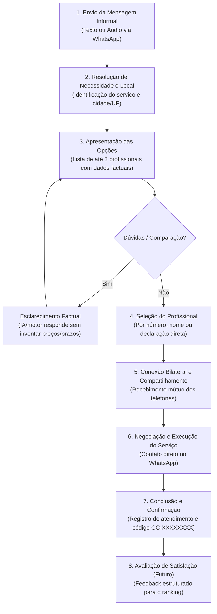
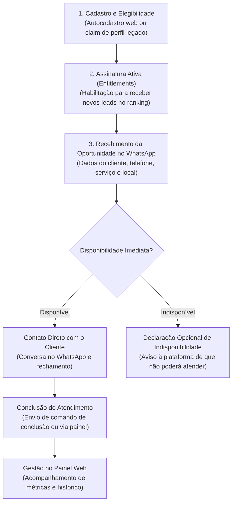

# Jornadas do Produto (Product Journeys)

Este documento descreve as jornadas dos atores do ecossistema do **ContatoCerto**, detalhando a experiência de ponta a ponta e diferenciando com precisão o **Comportamento Atual (CURRENT)** da **Direção Futura (TARGET)**.

---

## 1. Jornada do Cliente (Customer Journey)

O cliente interage exclusivamente pelo canal conversacional (WhatsApp), sem precisar baixar aplicativos ou realizar cadastros prévios.

### Etapas Detalhadas

#### 1. Entrada e Interpretação
* **CURRENT:** O cliente envia uma mensagem inicial em linguagem natural (áudio ou texto) descrevendo seu problema (ex.: *"meu chuveiro queimou e preciso de um eletricista em Sinop"*). O sistema processa o áudio via transcrição e resolve o serviço contra o catálogo oficial e a cidade contra a base IBGE.
* **TARGET:** Suporte a inputs de localização geográfica direta via WhatsApp (Live Location ou pino de mapa) e retenção inteligente com confirmação da última localização (*"É para Sinop - MT novamente?"*).

#### 2. Esclarecimento e Desambiguação
* Se faltar o serviço ou a localização, o assistente faz uma pergunta natural e objetiva. Se houver mais de um município homônimo (ex.: *Belém - PA* vs *Belém - PB*), o sistema solicita a confirmação do estado.

#### 3. Apresentação e Comparação
* O sistema apresenta até 3 profissionais elegíveis por página (com limite total de até 6 profissionais por busca).
* **CURRENT:** O cliente recebe uma mensagem estruturada com nome, especialidade e indicadores factuais disponíveis. O cliente pode escolher por número da opção (ex.: `1`) ou pelo nome do profissional.
* **TARGET (Conversation Intelligence v2):** O cliente poderá fazer perguntas comparativas factuais sobre os profissionais apresentados (ex.: *"Qual deles atende mais perto do centro?"*). O assistente responderá com base estritamente em dados reais cadastrados, sem nunca inventar estimativas de preço, prazos de garantia ou disponibilidade que não existam no sistema.

#### 4. Seleção e Consentimento Bilateral
* Ao escolher um profissional, o cliente autoriza o compartilhamento do seu número de WhatsApp com o prestador selecionado.
* **CURRENT:** A transação gera um registro `contacts` e envia o resumo ao cliente com o telefone do profissional e o código público `CC-XXXXXXXX`.
* **TARGET (Connection Lifecycle v2):** A seleção pelo cliente + consentimento mútuo de telefone = **CONEXÃO ESTABELECIDA IMEDIATAMENTE**. Não há dependência de aceite prévio do profissional para a conexão ser considerada real e ativa.

#### 5. Execução do Serviço no Mundo Real
* O cliente e o profissional negociam livremente pelo WhatsApp prazos, orçamentos, visitas técnicas e pagamentos. A plataforma não interfere na transação financeira do serviço.

#### 6. Conclusão e Confirmação
* **CURRENT:** Tanto o cliente quanto o profissional podem declarar a conclusão do atendimento enviando `concluído CC-XXXXXXXX`. O cliente pode confirmar com `confirmar CC-XXXXXXXX` ou contestar com `contestar CC-XXXXXXXX`.
* **TARGET:** Gatilhos conversacionais mais naturais e proativos que convidam o cliente a confirmar se o serviço foi realizado sem exigir a digitação manual do código quando o contexto da conversa for unívoco.

---

## 2. Jornada do Profissional (Professional Journey)

O profissional possui dois canais de interação: o WhatsApp (para notificações operacionais imediatas) e o Painel Web (para gestão e governança).

### Etapas Detalhadas

#### 1. Autocadastro e Gestão de Perfil
* O profissional acessa o portal web (`/dashboard`), solicita um código de acesso OTP via e-mail e faz login sem senha.
* Configura seus dados pessoais, categorias de serviço em que atua e cidades/bairros atendidos.

#### 2. Assinatura e Participação no Marketplace
* Para estar elegível a receber novos contatos, o profissional deve possuir uma assinatura ativa no sistema.
* **Regra Fundamental:** O profissional **não paga por lead**. Ele tem previsibilidade total de custo através do plano de assinatura.

#### 3. Recebimento de Oportunidades (Notificação no WhatsApp)
* Quando um cliente seleciona o profissional, o sistema despacha imediatamente uma mensagem via Outbox para o WhatsApp do profissional.
* **Modelo da Mensagem (TARGET):**
  > *"Olá, [Nome]! Um cliente selecionou você no ContatoCerto para o serviço de [Eletricista].*
  > *Resumo da necessidade: [Troca de disjuntor].*
  > *Localização: [Bairro Centro, Sinop - MT].*
  > *Telefone do cliente: [+55 66 99999-9999].*
  > *Por favor, entre em contato com o cliente o mais breve possível para alinhar o atendimento.*
  > *(Caso você esteja impossibilitado de atender neste momento, responda 'indisponível')".*

#### 4. Postura sobre Aceite vs. Conexão (CURRENT vs. TARGET)
* **CURRENT:** O banco de dados e a API ainda registram estados como `accepted` ou `rejected` para controlar certas transições internas do contato.
* **TARGET (ADR-004):** A conexão **já existe** no momento do envio. O profissional não precisa acessar o painel nem enviar comandos de confirmação para poder conversar com o cliente. O botão ou comando de recusa/indisponibilidade serve apenas como sinal de cortesia e telemetria operacional, e sua declaração é classificada como declaração unilateral do profissional, e não fato absoluto.

#### 5. Conclusão de Serviço
* Concluído o trabalho, o profissional pode sinalizar a finalização enviando `concluído CC-XXXXXXXX` pelo WhatsApp ou marcando como concluído no painel web.

---

## 3. Jornada do Operador / Administrador (Future Operator Journey)

Destinada aos mantenedores da plataforma para monitoramento, segurança e governança.

* **Auditoria de Mensageria:** Acompanhamento da saúde da Inbox e Outbox através de endpoints de telemetria agregada (`/internal/channel/inbox/diagnostics`), sem exposição de dados sensíveis ou PII nos logs.
* **Gestão de Quarentena:** Resolução de mensagens retidas na Inbox devido a conflitos de concorrência ou falhas de transporte.
* **Gestão de Catálogo e Mapeamento:** Ajuste de sinônimos de serviços e calibragem de tolerância de busca espacial.
* **Governança de Assinaturas:** Concessão, renovação ou encerramento manual de assinaturas profissionais enquanto os gateways de pagamento automatizados permanecem congelados.
