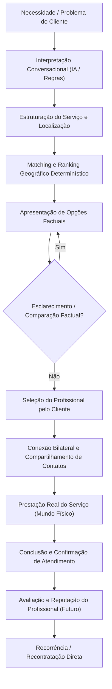

# ContatoCerto — Definição Canônica do Produto

O **ContatoCerto** é um marketplace conversacional de serviços locais que conecta clientes a prestadores de serviços qualificados de forma rápida, humanizada e transparente.

---

## 🎯 O Problema que Resolvemos

A contratação de serviços locais (eletricistas, encanadores, diaristas, técnicos, etc.) é tradicionalmente dolorosa e ineficiente para ambos os lados:

* **Para o Cliente:** É desgastante navegar por catálogos burocráticos, adivinhar categorias técnicas complexas, baixar aplicativos dedicados ou preencher formulários extensos apenas para conseguir o contato de um profissional disponível em sua região.
* **Para o Profissional:** As plataformas convencionais cobram taxas abusivas por lead ("créditos" por telefone), obrigando o profissional a pagar por contatos de clientes que muitas vezes sequer respondem ou que já contrataram outro fornecedor.

---

## 💡 Proposta de Valor

### Para o Cliente
* **Experiência 100% Gratuita:** O cliente não paga nada para buscar, comparar e se conectar com profissionais.
* **Linguagem Natural sem Fricção:** Não é necessário saber nomes técnicos de categorias ou navegar em árvores de menu rígidas. O cliente simplesmente descreve sua necessidade no WhatsApp com suas próprias palavras.
* **Sem Necessidade de App:** Todo o atendimento principal acontece via WhatsApp, sem cadastro prévio burocrático e sem downloads.
* **Opções Locais Reais e Relevantes:** O sistema identifica o serviço exato e a localização geográfica, apresentando os profissionais mais bem posicionados para atender.
* **Autonomia na Decisão:** O cliente recebe opções factuais, pode pedir esclarecimentos e escolhe ativamente com quem deseja falar.

### Para o Profissional
* **Sem Cobrança por Lead:** O profissional nunca é taxado por oportunidade recebida.
* **Leads Qualificados com Alta Intenção:** Quando uma conexão ocorre, foi o cliente que escolheu ativamente aquele profissional específico para o seu problema.
* **Previsibilidade Financeira:** Modelo baseado em assinatura recorrente com valor fixo e justo.
* **Autonomia Operacional:** O profissional recebe os dados diretamente no WhatsApp e negocia condições, preços e prazos diretamente com o cliente.
* **Painel Web Dedicado:** Área administrativa (`/dashboard`) para gerenciar dados cadastrais, cobertura de serviços, histórico de atendimentos e status da conta.

---

## 📱 Interfaces Principais

1. **Canal WhatsApp (Conversacional):**
   * Interface primária para clientes (descoberta, comparação, seleção, suporte e confirmação de atendimento).
   * Interface primária de notificação e comunicação rápida para profissionais (recebimento de oportunidades com dados de contato do cliente).
2. **Painel Web do Profissional (`/dashboard`):**
   * Aplicação web Next.js acessível via navegador móvel ou desktop.
   * Autenticação segura sem senha (OTP por e-mail).
   * Gerenciamento de perfil, serviços atendidos, cidades/bairros de atuação e visualização de atendimentos.

---

## 🔄 Visão do Ciclo do Produto

A jornada ideal e completa do ContatoCerto opera como um fluxo contínuo de confiança:

1. **Necessidade / Problema:** Cliente envia mensagem informal de áudio ou texto descrevendo o que precisa.
2. **Interpretação:** O sistema compreende a intenção, identifica o serviço do catálogo e extrai/confirma a cidade e o estado.
3. **Estruturação:** O pedido é validado determinísticamente contra o catálogo oficial e a malha geográfica.
4. **Matching:** Algoritmo justo de ranking espacial seleciona os profissionais mais adequados dentro do raio de cobertura.
5. **Apresentação:** O cliente recebe uma lista enxuta de opções (página de 3 profissionais) com dados factuais.
6. **Comparação / Esclarecimento:** Se o cliente tiver dúvidas, o assistente responde com dados objetivos da plataforma (sem inventar garantias ou preços).
7. **Seleção Ativa:** O cliente escolhe livremente por número, nome ou declaração direta de preferência.
8. **Conexão Bilateral:** Dados de contato (telefone WhatsApp) são trocados mutuamente entre cliente e profissional.
9. **Serviço no Mundo Real:** Negociação e execução acontecem livremente entre as partes.
10. **Conclusão:** Atendimento é registrado como concluído, permitindo auditoria e confirmação pelas partes.
11. **Avaliação e Reputação (Direção Futura):** Coleta de feedback e pontuação real de satisfação para alimentar o ranking.
12. **Recorrência:** Oportunidades futuras de recontratação e fidelização.

---

## 💼 Modelo de Negócio

* **Cliente:** Totalmente gratuito, sem taxas ocultas ou paywalls.
* **Profissional:** Monetização via assinatura periódica (mensal/anual) com planos que conferem elegibilidade para receber novas oportunidades no marketplace.
* **Regra Fundamental de Monetização:** **Sem taxa por lead.** Cobrar por lead degrada a experiência do profissional e incentiva atritos de plataforma.
* **Status Atual da Cobrança:** A integração com gateways de pagamento (Stripe, Mercado Pago, Asaas, etc.), checkout e emissão de Pix/cartão está **formalmente congelada** ([ADR-003](decisions/ADR-003-billing-provider-decision-frozen.md)). O domínio de assinaturas e direitos de acesso (*entitlements*) está modelado de forma agnóstica no banco de dados, permitindo concessão manual e controle administrativo sem acoplamento a provedores financeiros.

---

## ⚖️ Princípios Centrais do Marketplace

1. **Linguagem Natural em Primeiro Lugar:** A tecnologia serve ao usuário; o cliente fala naturalmente e o sistema se adapta, sem exigir códigos ou termos técnicos.
2. **Determinismo nas Decisões Críticas:** A Inteligência Artificial atua como intérprete de linguagem e facilitadora, mas nunca como autoridade sobre transações, cobrança, consentimento, identidade ou criação de contatos ([ADR-002](decisions/ADR-002-ai-interpretation-vs-deterministic-domain-authority.md)).
3. **Neutralidade e Transparência:** Recomendações e apresentações baseiam-se em critérios objetivos e auditáveis de catálogo, proximidade e cobertura. Não fabricamos dados de reputação, preços ou garantias que os profissionais não cadastraram.
4. **Privacidade e Consentimento:** Telefones só são compartilhados mediante ação consciente e voluntária de seleção por parte do cliente.
5. **Respeito aos Dados Históricos:** A expiração de uma assinatura profissional bloqueia a participação em *novas* oportunidades, mas nunca revoga nem apaga o histórico de clientes e contatos legitimamente estabelecidos no passado.
