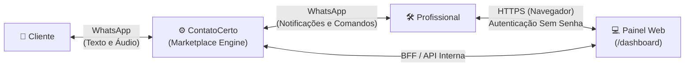
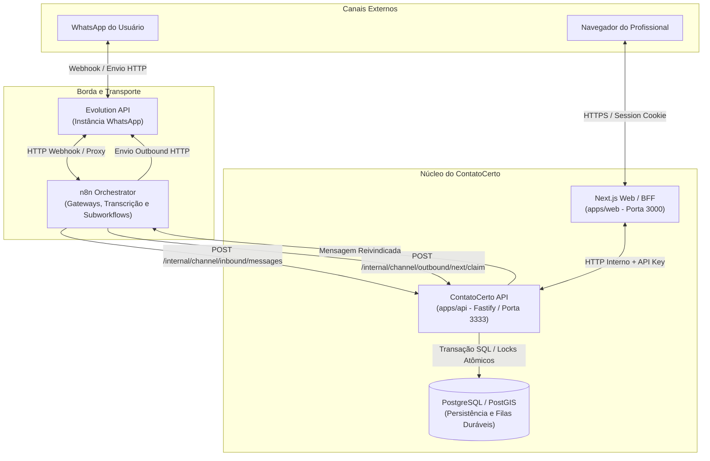
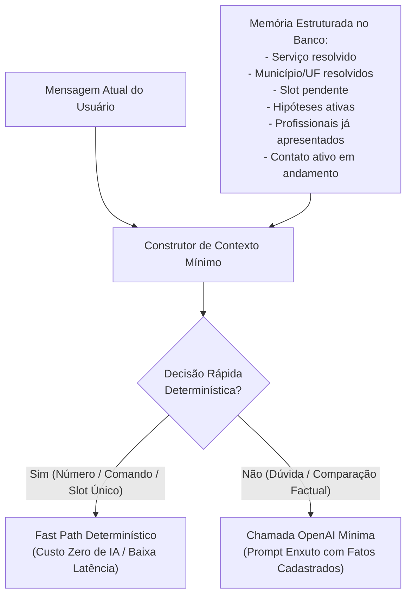

# Visão Técnica Geral (Technical Overview)

Este documento apresenta a arquitetura de alto nível do **ContatoCerto**, suas fronteiras de responsabilidade, o modelo de mensageria e contexto de IA, as diretrizes de localização e a taxonomia canônica do funil de dados.

---

## 1. Contexto do Sistema (System Context)

O ContatoCerto opera como um ecossistema conversacional centrado em interações assíncronas e em um portal web para gestão profissional:



---

## 2. Arquitetura de Contêineres e Fluxo de Mensagens

O fluxo de dados entre os serviços externos e o núcleo da aplicação segue uma separação rigorosa entre transporte, orquestração e autoridade de domínio:



### Rotas Canônicas de Mensageria e Fila
* **Entrada de Mensagens (Inbound):** `POST /internal/channel/inbound/messages`
* **Recuperação de Fila (Recovery):** `POST /internal/channel/inbound/next/process`
* **Reivindicação de Saída (Outbound Claim):** `POST /internal/channel/outbound/next/claim` (e `/internal/channel/outbound/:id/claim`)
* **Confirmação de Despacho:** `POST /internal/channel/outbound/:id/sent`, `/failed`, `/hold`
* **Recibos de Entrega Assíncronos (Delivery Receipts — WP-B):** `POST /internal/channel/outbound/receipts`

### Fronteiras de Responsabilidade e Invariantes

* **n8n (Orquestração de Integração e Transporte):** Responsável pelo transporte de entrada/saída, conversão de payloads de mensageria, retries de rede e execução de workflows externos de transcrição de áudio. No pipeline de recibos de entrega, o Gateway (`gateway.json`) recebe eventos assíncronos `messages.update` / `messages_update`, normaliza o status (`accepted`, `delivered`, `read`, `failed`, `unknown`) e despacha para a API via `POST /internal/channel/outbound/receipts`. O n8n **não detém lógica de negócio**, não toma decisões de autorização e não altera o ciclo de vida do outbox.
* **ContatoCerto API (Autoridade de Negócio e Domínio):** O backend Fastify é a autoridade absoluta sobre resolução de serviços, elegibilidade, criação de buscas, ranking espacial, consentimento, geração de contatos bilaterais, ciclo de vida de atendimentos e persistência idempotente de recibos de entrega.
* **PostgreSQL / PostGIS (Persistência Canônica):** Camada de dados única e centralizada. É a guardiã das transações, tabelas de fila (`channel_inbound_messages`, `channel_outbound_messages`), recibos de entrega auditáveis e imutáveis (`channel_outbound_receipts`), locks concorrentes (`FOR UPDATE`) e do catálogo geográfico.
* **Direção de Mensageria e Execução (TARGET — [ADR-008](decisions/ADR-008-direct-meta-and-bullmq-transactional-migration.md)):** O caminho crítico transacional migrará para Meta WhatsApp Cloud API direta (Graph API v26.0) e camada de execução BullMQ/Redis com workers dedicados (`contatocerto-worker`), removendo o n8n do hot-path (`REMOVED_FROM_TRANSACTIONAL_HOT_PATH`) e mantendo a Evolution API estritamente como fallback temporário (`TEMPORARY_FALLBACK_THEN_DECOMMISSION`). O PostgreSQL permanece como autoridade soberana e Fonte da Verdade de negócio.

### Observabilidade de Recibos de Entrega Assíncronos (CURRENT — WP-B / Migration 030)

O ContatoCerto implementa separação estrita entre o aceite síncrono pelo provedor e o ciclo assíncrono de entrega:

* **Status de Implementação e Limitações Operacionais:**
  * `CODE SUPPORT = YES`: O código versionado suporta ingestão, normalização, persistência append-only e idempotência de recibos (`messages.update` / `messages_update`).
  * `PRODUCTION EVENT SUBSCRIPTION = NO`: Webhook de status callbacks não está habilitado em produção.
  * `PRODUCTION RUNTIME VERIFIED = NO`: Nenhuma homologação de produção foi executada para eventos de status.
  * `EVOLUTION_2_3_7_WHATSAPP_BUSINESS_STATUS_LIMITATION = YES`: A Evolution 2.3.7 + WHATSAPP-BUSINESS possui limitação upstream conhecida no processamento de status callbacks, podendo impedir a emissão de `MESSAGES_UPDATE`. A existência de suporte no código WP-B não significa que produção esteja operacionalmente habilitada ou homologada.
  * `EVOLUTION_2_3_7_ERROR_DETAILS_LIMITATION = YES`: Detalhes de erro da Meta (como `error_data.details`) não fazem parte do payload de `MESSAGES_UPDATE` da Evolution 2.3.7 stock, sendo tratados de forma defensiva apenas quando factualmente presentes em versões patchadas.
* **Semântica Invariante de `status = 'sent'`:** Na tabela `channel_outbound_messages`, o estado `'sent'` expressa única e exclusivamente que o provedor aceitou o payload e retornou um identificador autoritativo (`wamid`). Ele **não** significa que a mensagem chegou ao aparelho do destinatário.
* **Tabela Imutável de Recibos (`channel_outbound_receipts`):** Cada evento de atualização de status recebido da Evolution/Meta é persistido como registro autônomo, vinculado à mensagem correspondente através de `outbound_message_id`. Triggers em nível de linha e comando bloqueiam qualquer `UPDATE`, `DELETE` ou `TRUNCATE` (`OUTBOUND_RECEIPT_IMMUTABLE`, código `P0030`), e o rollback da migration é protegido (`OUTBOUND_RECEIPT_ROLLBACK_BLOCKED`, código `P0030`).
* **Idempotência Criptográfica Canônica:** Um fingerprint SHA-256 é calculado deterministamente a partir da serialização JSON inequívoca de `[provider, provider_message_id, provider_status, normalized_status, provider_event_at ?? null, provider_error_code ?? null]`, evitando ambiguidades de delimitação e garantindo deduplicação atômica no banco sem efeitos colaterais caso a Meta reenvie webhooks.
* **Ausência de Efeitos Colaterais no Domínio:** Nenhum recibo assíncrono altera o campo `status` da tabela `channel_outbound_messages`, nem reinicia retentativas de envio. Falhas assíncronas (como o erro Meta `131047` — janela de 24h fechada) são registradas estritamente para observabilidade e auditoria, sem invalidar ou reemitir challenges de OTP automaticamente.

### Autoridade Compartilhada de Domínio Pós-Conexão (CURRENT — WP6.3)

As mutações transacionais de negócio do ciclo pós-conexão convergem para métodos de domínio compartilhados e neutros de provedor (`apps/api/src/modules/contact-completion/contact-completion.domain.ts` e `apps/api/src/modules/professional-opportunity/professional-unavailability.domain.ts`):

* **Separação entre Entrada e Domínio:** O parsing de comandos textuais e a resolução de alvos operam fora da autoridade de mutação de domínio.
* **Operações Transacionais Canônicas:**
  * **Declaração de Conclusão:** `executeCompletionDeclaration(db, contact, actorRole, inboundId, options?)`
  * **Confirmação de Conclusão:** `executeCompletionConfirmation(db, contact, actorRole, inboundId, options?)`
  * **Contestação de Conclusão:** `executeCompletionContestation(db, contact, actorRole, inboundId, options?)`
  * **Declaração de Indisponibilidade:** `executeUnavailabilityDeclaration(db, contact, professionalId, inboundId, options?)`
* **Responsabilidade de Locks e Contexto Transacional:** As operações compartilhadas de domínio executam dentro do contexto transacional e de serialização estabelecido pelo chamador autorizado. O chamador é responsável por adquirir os locks canônicos do alvo/contato (`FOR UPDATE` / `FOR NO KEY UPDATE`) antes da delegação, enquanto a autoridade de conclusão preserva o lock do agregado de conclusão (`contact_completions FOR UPDATE`) e todos os invariantes atômicos de estado, ledger e outbox. Futuros chamadores por token interativo no WP6.4 **devem obrigatoriamente** adquirir o mesmo contexto canônico de autorização e locking antes de invocar estas operações de domínio.
* **Neutralidade de Provedor e Invariantes:** As operações de domínio realizam transições atômicas de estado, persistência de eventos imutáveis no ledger e geração de notificações de contraparte na outbox sem conhecer detalhes ou acoplamentos de provedor de mensageria.
* **Comportamento Textual Inalterado:** Os serviços textuais vigentes (`ContactCompletionService`, `ProfessionalOpportunityService`) delegam integralmente a essas operações de domínio, mantendo 100% de compatibilidade e comportamento idêntico.
* **Sequenciamento de Ações Interativas (ADR-006):**
  * **WP6.2 (Implementado):** Fundação relacional (Migration 028) e schemas neutros em `@contatocerto/shared`.
  * **WP6.3 (Implementado):** Autoridade transacional compartilhada de domínio extraída e preservação do comportamento textual.
  * **WP6.4 (Implementado no repositório):** Runtime de tokens de ação (`InteractiveActionService`), emissão/consumo transacional, outbox interativa e roteamento dual-path no Channel Inbox.
  * **WP6.5 (Implementado no repositório):** Adaptadores de transporte n8n para payloads interativos (`sendButtons` e templates), extração autoritária de IDs interativos no Gateway, suporte a respostas de transporte Meta Cloud e testes de contrato automatizados (`pnpm test:workflows`).
  * **WP6.9 / Gate B (Homologado em Produção Real — CLOSED / PASS):** Preservação ponta a ponta do ID de ação (`Meta button.payload -> interactive_action_id`), resolução canônica do Webhook no Gateway n8n (PR #40), consumo de token atômico exactly-once e conclusão bilateral de atendimento comprovada ([`docs/launch-readiness/01-wp6-9-gate-b-closeout.md`](launch-readiness/01-wp6-9-gate-b-closeout.md)).
* **Fronteira de Transporte, Ingress e Invariantes Interativos:**
  * **Eventos Interativos Estruturados sem ID:** Se um evento de resposta for estruturalmente interativo mas não contiver um ID de ação autoritativo, o Gateway rejeita de forma segura com `unsupported_interactive_reply` (HTTP 200).
  * **Eventos Achatados em Texto Simples (`message.conversation`):** Se a camada de transporte (como a Evolution 2.3.7) achatar o clique em um texto comum com o rótulo do botão (ex.: "Confirmar"), o Gateway não tem garantia criptográfica de origem e processa o evento como texto comum, sem atribuir `interactive_action_id`. O fallback textual permanece estritamente preservado e o sistema **jamais** aplica heurísticas de adivinhação sobre texto livre.
  * **Gate de Ativação Concluído:** A preservação do ID ponta a ponta foi comprovada no caminho de produção Meta Cloud API -> Evolution API -> n8n Gateway, com preservação do payload estruturado `message.button.payload -> interactive_action_id` e consumo atômico de token de ação.

---

## 3. Arquitetura de Contexto e Inteligência Artificial

### Princípio da Minimização de Contexto
Ao contrário de agentes convencionais de chat, o ContatoCerto **NÃO envia o histórico arbitrário e integral de mensagens para modelos LLM por padrão**.

O sistema prioriza a construção e manutenção de um **Estado Conversacional Estruturado**:



### Estado Atual vs. Alvo (Target)
* **CURRENT (Conversation Intelligence & Selection v2 — PR #18):** O motor conversacional B2 aceita perguntas e comparações do cliente sobre prestadores apresentados na fase de seleção (`pending="selection"`). O pipeline opera com as seguintes garantias arquiteturais:
  * **Minimização Estrita de Contexto:** Apenas os candidatos apresentados na página ativa (`shownCandidates`, até 3 profissionais) são enviados como contexto estruturado seguro (sem números de telefone, sem transcrição bruta e sem PII de cliente).
  * **Fast Paths Determinísticos (0 IA):** Perguntas diretas de distância (*"qual o mais perto?"*) e de preço (*"qual o mais barato?"*) são resolvidas via `contextual.fast-path.ts` sem nenhuma chamada a modelos LLM.
  * **Apresentador Factual Determinístico (0 Composição):** Dúvidas interpretadas pela IA sobre candidatos (`inquire_candidate`, `compare_candidates`) são formatadas exclusivamente via `SelectionInquiryPresenter` com base em dados reais do banco, executando **0 chamadas de composição de IA**.
  * **Resolução de Conclusão Sem Código:** O módulo de conclusão resolve frases em linguagem natural (*"já terminei"*, *"confirmo"*) para 1 contato elegível único via parser determinístico sem chamadas a LLMs.
* **TARGET:** Expansão da inteligência conversacional para gestão proativa de reagendamentos e acompanhamento pós-conclusão.

---

## 4. Diretrizes de Localização (Location v2)

### CURRENT (Implementado no Repositório)
* **Resolução Municipal em Memória:** Snapshot versionado de municípios do IBGE (`apps/api/src/modules/location-resolution/data/brazil-municipalities.json`), desambiguação cidade/UF e fallback geográfico via API Pelias / openrouteservice (HeiGIT).
* **Cobertura Espacial PostGIS:** O PostGIS é utilizado separadamente para indexação espacial da malha de atendimento dos profissionais na tabela `professional_service_areas` (`center` e `radius_meters`), cálculo de raio com `ST_DWithin` e ordenação do matching.
* Suporte a buscas com cidade e estado expressos no texto.
* Resolução de ambiguidades com perguntas estruturadas.

### TARGET (Location v2 — Planejado)
* **Estrutura Mínima Obrigatória:** Cidade + Estado (UF).
* **Níveis Opcionais de Refinamento:** Bairro, CEP, logradouro/número, ponto de referência e coordenadas exatas (latitude/longitude).
* **Novas Entradas no WhatsApp:**
  * Mensagens com localização nativa (compartilhamento de pino do WhatsApp);
  * Eventos de Live Location (quando suportados pelo canal);
  * Links de mapas (Google Maps / Waze).
* **Localização Reutilizada (Remembered Location):**
  * Quando um cliente recorrente inicia uma nova busca, o sistema **NUNCA deve reutilizar silenciosamente a localização anterior**.
  * A experiência canônica deve solicitar confirmação explícita: *"É para Sinop - MT novamente?"*.
  * O cliente pode alterar sua localização a qualquer instante.
  * O histórico de buscas passadas é imutável por requisição.

---

## 5. Portal Web do Profissional (`/dashboard`)

* **Rota Canônica:** `/dashboard` (aplicação Next.js em `apps/web`).
* **Capacidades Atuais:**
  * Autenticação passwordless via código OTP de 6 dígitos no WhatsApp com TTL de 5 minutos;
  * Sessão segura via cookie assinado no BFF (`DASHBOARD_SESSION_SECRET`);
  * Edição de dados cadastrais de perfil (nome, bio; telefone de contato em modo somente-leitura);
  * Seleção de categorias de serviços atendidos e municípios de cobertura;
  * Configuração de disponibilidade e elegibilidade;
  * Fluxos de autocadastro e reivindicação de perfil legado (claim).
* **Direção Futura (Dashboard v2):**
  * Tela de histórico de atendimentos e conclusão de serviços;
  * Visualização de métricas de conversão e exposição (quantas vezes o perfil foi exibido no WhatsApp);
  * Gestão de status de verificação e reputação;
  * Consulta de planos e status da assinatura;
  * Galeria de fotos de serviços anteriores (portfólio).
* **Regra Inviolável de Governança:** O painel é uma ferramenta de gestão e autosserviço; o profissional **nunca** depende dele para receber um lead ou atender um cliente.

---

## 6. Vocabulário Canônico do Funil de Métricas (Funnel Canon)

Para evitar ambiguidades conceituais entre relatórios operacionais e algoritmos de recomendação, o ContatoCerto estabelece a seguinte cadeia estrita de eventos:

```
[candidate] 
    → [persisted match] 
    → [shown] 
    → [selected] 
    → [bilateral connection] 
    → [professional-declared unavailable] 
    → [completion] 
    → [future review]
```

1. **`candidate`:** Profissional existente no banco que atende à categoria e ao raio geográfico da busca.
2. **`persisted match`:** Candidato selecionado pelo algoritmo de matching e persistido na tabela `matches` com rank relativo.
3. **`shown`:** Profissional efetivamente apresentado em uma mensagem enviada ao cliente (`shown_at` preenchido após confirmação de entrega do bloco de 3).
4. **`selected`:** Profissional escolhido ativamente pelo cliente através de número, nome ou declaração textual (`selected_at` preenchido).
5. **`bilateral connection`:** Momento transacional em que os telefones de ambas as partes são compartilhados e o atendimento é registrado diretamente como `status = 'shared'` (Migration 027).
6. **`professional-declared unavailable`:** Sinalização opcional do profissional indicando que não poderá realizar o atendimento no momento (declaração unilateral imutável em `professional_unavailability_events` protegida por `P0027`).
7. **`completion`:** Marcação do atendimento como encerrado, com confirmação ou contestação bilateral registrada (`contact_completions`). Elegível diretamente a partir do status `shared`.
8. **`future review`:** Coleta posterior de pontuação e comentário de satisfação.

---

## 7. Variáveis de Ambiente e Precedência de Configuração

A tabela a seguir documenta os nomes canônicos e responsabilidades das variáveis de configuração do sistema. **Nenhum valor secreto ou credencial é documentado aqui.**

| Subsistema | Variável de Ambiente | Finalidade / Regra de Precedência |
| :--- | :--- | :--- |
| **Banco de Dados** | `DATABASE_URL` | String de conexão com PostgreSQL/PostGIS. |
| **API Backend** | `API_PORT` | Porta de escuta da API Fastify (padrão: 3333). |
| **API Backend** | `INTERNAL_API_KEY` | Chave de autenticação para endpoints administrativos internos. |
| **Catálogo de Serviços** | `SERVICE_RESOLUTION_FUZZY_THRESHOLD` | Limite de calibragem fuzzy para identificação de serviços. |
| **Geocodificação** | `OPENROUTESERVICE_BASE_URL` | Endpoint da API HeiGIT/Pelias para fallback de municípios. |
| **Geocodificação** | `OPENROUTESERVICE_API_KEY` | Chave de acesso à API HeiGIT. |
| **Autenticação Web** | `PROFESSIONAL_AUTH_ENABLED` | Flag booleana que habilita a emissão pública de OTP no WhatsApp. |
| **Autenticação Web** | `PROFESSIONAL_AUTH_PEPPER` | Segredo criptográfico (mínimo 32 bytes) para derivar chave HMAC e AES do OTP e Outbox. |
| **Portal Web / BFF** | `CONTATOCERTO_API_URL` | URL base da API consumida pelo backend do portal web. |
| **Portal Web / BFF** | `DASHBOARD_SESSION_SECRET` | Segredo utilizado para assinar o cookie de sessão do profissional. |
| **Fila e Leases** | `CHANNEL_INBOUND_PROCESSING_LEASE_SECONDS` | Tempo de lease para recuperação de mensagens travadas na tabela `channel_inbound_messages`. |
| **Fila e Leases** | `CHANNEL_OUTBOUND_PROCESSING_LEASE_SECONDS` | Tempo de lease para envio de mensagens pela tabela `channel_outbound_messages` via n8n. |
| **Conversação IA** | `CONVERSATION_AI_ENABLED` | **Flag canônica principal** (padrão no código: `false`; snapshot instalado do operador reportado como `true`). |
| **Conversação IA (Legacy)**| `CONTEXTUAL_CONVERSATION_ENABLED` | *Alias legado.* O código audita ambas as variáveis, e **`CONVERSATION_AI_ENABLED` tem precedência absoluta** caso ambas estejam definidas. |
| **Modelo de IA** | `OPENAI_CONVERSATION_MODEL` | Nome do modelo LLM homologado para a conversação (ex.: gpt-5.6-luna). *(Tem precedência sobre o alias legado `CONTEXTUAL_CONVERSATION_MODEL`)*. |
| **Modelo de IA** | `OPENAI_CONVERSATION_TIMEOUT_MS` | Timeout máximo para requisições de modelo (padrão: 20000ms). |
| **Ações Interativas** | `INTERACTIVE_ACTIONS_ENABLED` | Flag booleana que habilita a emissão de tokens de ação opacos e outbounds interativos (botões) para ações pós-conexão (padrão: `false`). |
